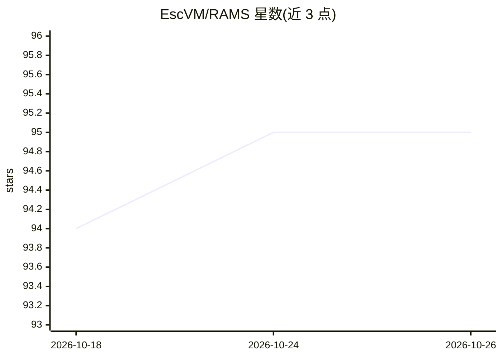

# EscVM/RAMS

⭐ 95 · Jupyter Notebook · Apache-2.0 · 推送 2026-01-10 · [GitHub](https://github.com/EscVM/RAMS) · [官网](https://www.mdpi.com/2072-4292/12/14/2207) · 个人维护

**遥感多帧超分辨率论文官方代码：Proba-V 数据集与预训练 RAMS 网络**

论文 "Multi-Image Super Resolution of Remotely Sensed Images Using Residual Attention Deep Neural Networks" 的官方 TensorFlow 实现。提供三部分内容：ESA 2019 年 Proba-V 数据集及预处理 notebook，输出 X(128x128 多帧)与 y(384x384)张量；RAMS 残差注意力网络的预训练权重，可用于训练、修改与测试；训练/测试 notebook 支持在验证集上评估并可打包提交 ESA post-mortem 挑战。作者团队曾在该挑战 post-mortem 排名中获得第一名。需主机预装 Python3 与 TensorFlow 2.x。

## 筛选速览

| 维度 | 判定 | 备注 |
|---|---|---|
| AI 角色 | `ai-native` | 本体是模型或模型工具 |
| 许可风险 | `permissive` | Apache-2.0 |
| 部署形态 | `library` | 以包/库形式分发 |
| 模型依赖 | — | README 未给出锁定关系 |
| 硬件要求 | — | 无带数字的原话,不猜 |
| 安装摩擦 | `low` | 无编译、无系统依赖或容器化 |
| 成熟度 | — | 结构信号不足 |

## 能力要点

- Proba-V 数据集预处理 pipeline（已划分训练/验证/测试）
- RAMS 残差注意力多帧超分辨率网络的预训练权重
- 三个 notebook：预处理、训练、测试与 ESA 提交打包

## 适用场景

- 在 Proba-V 数据集上复现或改进多帧超分辨率方法
- 用预训练 RAMS 权重生成超分辨率预测并提交 ESA post-mortem 评测
- 在统一验证集上与文献中主要方法对比结果

## 场景标签

`图像视频处理` `模型训练` · 领域:感知与多模态

## 证据(README 行号)

> L11: - Give easy access to a unique dataset, introduced by ESA in 2019, to work on the very challenging task of multi-fr
> L13: - Give access to our pre-trained solution (RAMS) that me and fsalv in a joint effort we have conceptualized and imp

## 星数曲线

2026-10-18 94 → 2026-10-26 95（+1）

---
*卡片 v1 · prompt 1.4 · 生成 2026-10-23 · 置信度 mid · 依据 README sha `3a65e4fc3ea9` · [字段定义](../../DATASET.md)*
