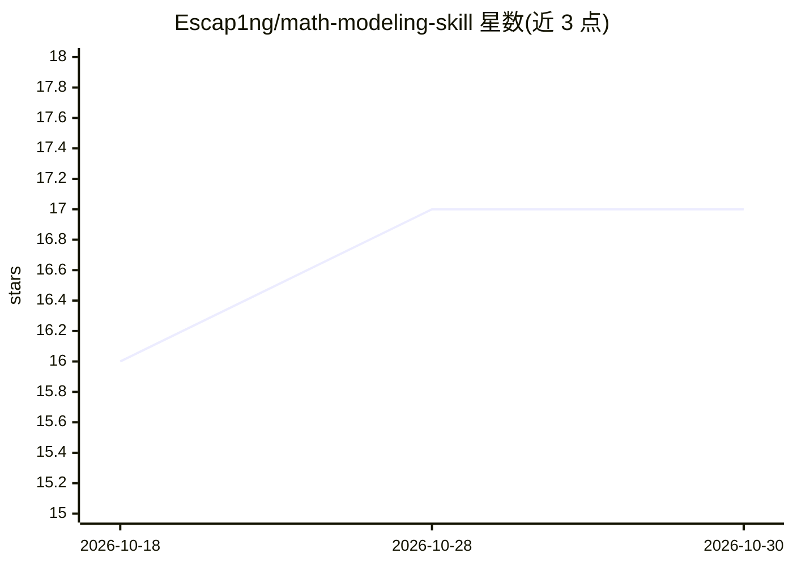

# Escap1ng/math-modeling-skill

⭐ 17 · MIT · 推送 2026-10-29 · [GitHub](https://github.com/Escap1ng/math-modeling-skill) · 个人维护 · 中文 README

**数学建模竞赛全流程 AI 技能文件：赛题分析到论文交付**

本体为一份 SKILL.md 技能文件，复制到 agent（如 Claude）技能目录即可使用，无插件与脚本。装入后按七阶段工作流执行：环境预检（自动安装 xelatex/pandoc/Python 依赖）、赛题分析、目录创建、算法选择（每问 2–3 候选五维择优）、代码实现、xelatex+pandoc 双格式论文输出、百分制五维自评（≥85 分定稿，最多 3 轮修改熔断）。内置算法速查库、国赛排版规范、Nature 三色可视化样式模块。适用 CUMCM、MCM/ICM 等多项赛事。

## 筛选速览

| 维度 | 判定 | 备注 |
|---|---|---|
| AI 角色 | `ai-ecosystem` | LLM/agent 周边工具 |
| 许可风险 | `permissive` | MIT |
| 部署形态 | `library` | 以包/库形式分发 |
| 模型依赖 | — | README 未给出锁定关系 |
| 硬件要求 | — | 无带数字的原话,不猜 |
| 安装摩擦 | `low` | 无编译、无系统依赖或容器化 |
| 成熟度 | — | 结构信号不足 |

## 能力要点

- 单文件 SKILL.md，复制到 agent 技能目录即装
- 七阶段工作流：环境预检→赛题分析→算法选择→代码→论文→评分闭环
- xelatex 生成 PDF + pandoc 生成 Word（公式转 OMML 可编辑）双格式交付
- 百分制五维评分，≥85 分定稿，3 轮未达标熔断标注人工复核

## 适用场景

- 参加 CUMCM/MCM 等数学建模竞赛时让 AI agent 辅助完成建模全流程
- 需要符合国赛匿名与排版规范的论文产出
- 按统一可视化样式生成出版级图表

## 场景标签

 · 领域:数学建模/竞赛工具

## 证据(README 行号)

> L19: 面向数学建模竞赛的全流程 AI 辅助技能：**赛题理解 → 模型构建 → 算法实现 → 论文输出 → 质量自评**。技能本体是一份 Markdown（`SKILL.md`），复制即装；定稿一次给出 PDF 与 Word（公式为 W
> L39: 把根目录的 `SKILL.md` 复制到所用 agent 的技能目录即可（各工具目录位置不同，以其文档为准；文件夹名须与 `SKILL.md` 头部的 `name: math-modeling-helper` 一致，例如 `~/.

## 星数曲线

2026-10-18 16 → 2026-10-30 17（+1）

---
*卡片 v1 · prompt 1.4 · 生成 2026-10-30 · 置信度 mid · 依据 README sha `72b1ac211d3f` · [字段定义](../../DATASET.md)*
