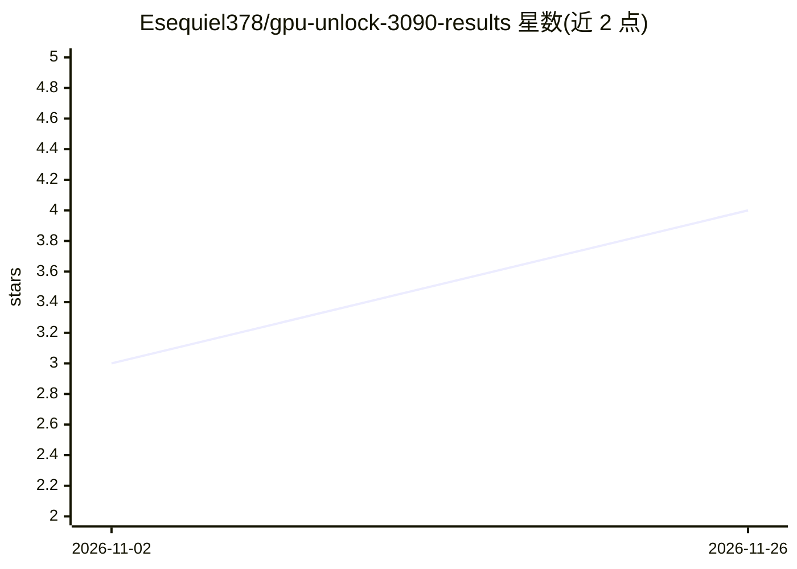

# Esequiel378/gpu-unlock-3090-results

⭐ 4 · Python · MIT · 推送 2026-10-28 · [GitHub](https://github.com/Esequiel378/gpu-unlock-3090-results) · 个人维护

**RTX 3090 解锁 GPU 节流的基准测试数据与复现脚本集**

本仓库记录对上游 GPU Unlock 内核模块（解除 RTX 30 系 FP16/BF16 张量核节流）的测量：在 RTX 3090 上对图像生成（ComfyUI）、vLLM prefill/decode、GEMM 等负载做三开机关闭-开启-关闭对照与 ABBA 区块计时，附能耗、SHA-256 正确性校验、原始 CSV 数据与 NixOS 模块。面向想在自己显卡上复现或评估该解锁效果的用户。README 注明失败解锁需完全断电才能恢复，且单卡结果不具普适性。

## 筛选速览

| 维度 | 判定 | 备注 |
|---|---|---|
| AI 角色 | `ai-knowledge` | 知识聚合/清单类 |
| 许可风险 | `permissive` | MIT |
| 部署形态 | `None` |  |
| 模型依赖 | — | README 未给出锁定关系 |
| 硬件要求 | — | 无带数字的原话,不猜 |
| 安装摩擦 | `low` | 无编译、无系统依赖或容器化 |
| 成熟度 | — | 结构信号不足 |

## 能力要点

- 图像生成提速 51–55%、vLLM prefill 提速 61–68%、能耗下降 33–42%（作者自报数据）
- 540 个浸泡批次与 260 次哈希校验运行全部位一致，无 Xid 错误
- 提供 runs.csv/samples.csv/env.json 原始数据与 summarize.py/bench.py 复现脚本
- 提供 NixOS 模块，从 initrd 在 NVIDIA 驱动绑定前加载解锁模块

## 适用场景

- 在自己的 RTX 30 系卡上评估解锁 FP16/BF16 节流前后的吞吐与能耗
- 复现这套包含哈希校验的三会话基准测试方法
- 在 NixOS 上以模块方式启用 GPU Unlock 并保留 stock 启动项

## 场景标签

`模型评测` · 领域:评测与运维

## 证据(README 行号)

> L3: GPU Unlock is a small open-source Linux kernel module that lifts the GeForce throttle on FP16/BF16 tensor-core math 
> L163: All the unlock work is Zagitta/gpu-unlock and its contributors. This repo only measures it. A NixOS flake for it i
> L79: Raw data for each session is in `results/<session>/`:

## 星数曲线

2026-11-02 3 → 2026-11-26 4（+1）

---
*卡片 v1 · prompt 1.4 · 生成 2026-11-26 · 置信度 high · 依据 README sha `7ae16ad7bb89` · [字段定义](../../DATASET.md)*
