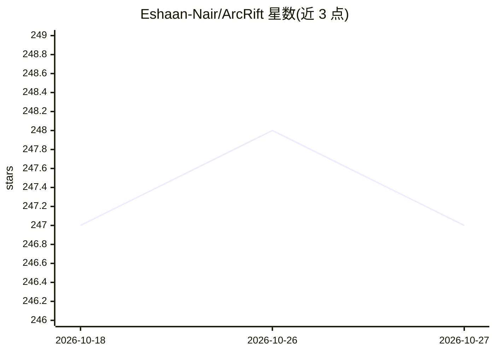

# Eshaan-Nair/ArcRift

⭐ 247 · TypeScript · MIT · 推送 2026-07-07 · [GitHub](https://github.com/Eshaan-Nair/ArcRift) · [官网](https://arcrift.vercel.app/) · 个人维护

**给 AI 编程工具与浏览器聊天的本地持久记忆层**

本地优先的记忆层，由浏览器扩展、原生 MCP 服务器与后端组成：浏览器扩展从 Claude/ChatGPT/Gemini/DeepSeek/Grok/Copilot/Mistral 的聊天中保存对话，经 PII 清理、分块后用 Ollama 本地嵌入，抽取为 SQLite 知识图谱三元组；MCP 服务器向 Claude Code/Cursor/Windsurf/Claude Desktop 提供 7 个记忆工具（recall_context、store_memory 等），扩展侧在新提示前自动注入相关上下文。检索采用句向量+块向量+FTS5 关键词三层混合搜索、HyDE 与 small-to-big 策略。运行需 Node.js 20+ 与 Ollama，Docker 模式可选。

## 筛选速览

| 维度 | 判定 | 备注 |
|---|---|---|
| AI 角色 | `ai-ecosystem` | LLM/agent 周边工具 |
| 许可风险 | `permissive` | MIT |
| 部署形态 | `desktop` | 安装包/桌面程序 |
| 模型依赖 | local-ok | 支持本地模型 |
| 硬件要求 | — | 无带数字的原话,不猜 |
| 安装摩擦 | `low` | 无编译、无系统依赖或容器化 |
| 成熟度 | — | 结构信号不足 |

## 能力要点

- 浏览器聊天与 IDE agent 共享同一 SQLite 知识图谱数据库
- 三层混合检索（句向量/块向量/FTS5）+ HyDE + small-to-big
- MCP 提供 7 个记忆工具，扩展支持自动上下文注入
- 本地优先：嵌入与抽取通过本地 Ollama 完成，无云端依赖

## 适用场景

- 把 ChatGPT/Claude 网页聊天中的决策同步给 Cursor/Claude Code 等编程 agent
- 跨会话保留项目上下文，避免反复重新解释
- 通过 Dashboard 浏览知识图谱与对话历史

## 场景标签

`Agent 记忆` `知识图谱` · 领域:Agent 开发

## 证据(README 行号)

> L6: **A local-first memory layer that captures your conversations, builds a searchable knowledge graph, and automaticall
> L16: **MCP (AI Coding Tools):** Claude Code · Cursor · Windsurf · Claude Desktop

## 星数曲线

2026-10-18 247 → 2026-10-27 247（+0）

---
*卡片 v1 · prompt 1.4 · 生成 2026-10-22 · 置信度 high · 依据 README sha `1d3d8c3ee9e6` · [字段定义](../../DATASET.md)*
