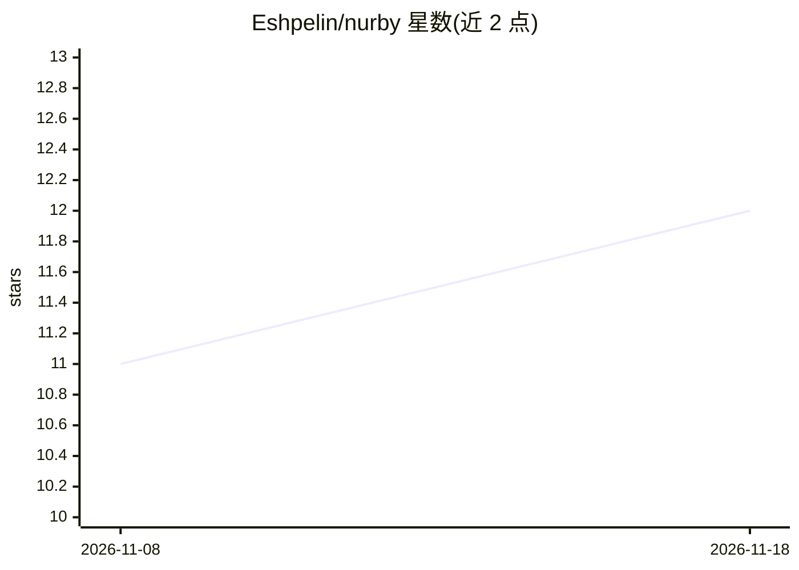

# Eshpelin/nurby

⭐ 12 · Python · AGPL-3.0 · 推送 2026-11-13 · [GitHub](https://github.com/Eshpelin/nurby) · [官网](https://nurby.ai/) · 个人维护

**自托管 NVR：将 IP 摄像头接入视觉模型，支持自然语言查询**

运行在自有服务器上的自托管网络视频录像机（NVR）与 AI 监控平台：接入 RTSP/ONVIF 摄像头，本地运行目标检测与人脸识别，用视觉语言模型生成场景描述，并允许用自然语言提问检索录像。可独立使用，也可与 Frigate、Blue Iris、Scrypted 配合。通过 Docker Compose 部署，覆盖 macOS/Windows/Linux；本地模型下视频不出内网。规则引擎支持通知、邮件、webhook、物理警报，并提供 REST API、webhook 与 MCP server。

## 筛选速览

| 维度 | 判定 | 备注 |
|---|---|---|
| AI 角色 | `ai-native` | 本体是模型或模型工具 |
| 许可风险 | `viral` | AGPL-3.0 |
| 部署形态 | `self-host` | docker 或自建部署 |
| 模型依赖 | local-ok | 支持本地模型 |
| 硬件要求 | — | 无带数字的原话,不猜 |
| 安装摩擦 | `low` | 无编译、无系统依赖或容器化 |
| 成熟度 | — | 结构信号不足 |

## 能力要点

- 接入 RTSP/ONVIF 摄像头，YOLO 目标检测与人脸识别本地运行
- 视觉语言模型生成场景描述，支持自然语言问答检索录像
- FindAnything 开放词表搜索，查找 COCO 80 类之外的物体
- MQTT 自动 Home Assistant 发现，REST API/webhook/MCP server 可编程扩展

## 适用场景

- 家庭安防：识别陌生人到访并触发警报、录制片段
- 照看幼儿与老人：被动状态检查、哭声/烟警音频触发
- 小店与农场：多摄像头覆盖、车牌识别、每日摘要
- 把摄像头事件通过 webhook 接入 Home Assistant 或 n8n 自动化

## 场景标签

`目标检测` `人脸识别` · 领域:感知与多模态

## 证据(README 行号)

> L79: Nurby is free, open-source software for recording and understanding your security cameras on your own server. It is
> L84: - **Bring your own brain.** Use a free local model through Ollama, or OpenAI, Anthropic, or Gemini. Swap them per c
> L85: - **It understands, not just detects.** YOLO finds objects, faces are recognized and grouped into people, and a vis

## 星数曲线

2026-11-08 11 → 2026-11-18 12（+1）

---
*卡片 v1 · prompt 1.4 · 生成 2026-11-18 · 置信度 mid · 依据 README sha `6f3b3d55f647` · [字段定义](../../DATASET.md)*
