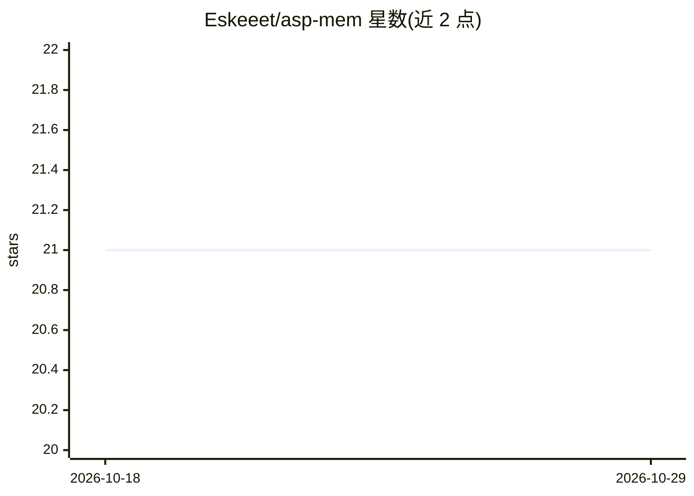

# Eskeeet/asp-mem

⭐ 21 · TypeScript · MIT · 推送 2026-07-27 · [GitHub](https://github.com/Eskeeet/asp-mem) · 个人维护

**面向对话 agent 的厂商无关长期记忆库（TypeScript）**

为对话式 agent 提供长期记忆循环的 TypeScript 库，不绑定模型、嵌入提供方、agent 框架或数据库。核心零运行时依赖，可在 Node.js 与浏览器运行，内置内存存储用于原型，另有 Supabase+pgvector 适配器做持久化。机制包括带置信度与出处的时间性观察、不可变修订历史、层级作用域隔离、语义+BM25 混合检索、token 预算内的上下文构建、默认 dry-run 的记忆合并，以及含 recall@k 等指标的评测工具。自声明为早期 0.2.x API。源自私有应用 Aspiritual 的记忆设计抽取重写。

## 筛选速览

| 维度 | 判定 | 备注 |
|---|---|---|
| AI 角色 | `ai-ecosystem` | LLM/agent 周边工具 |
| 许可风险 | `permissive` | MIT |
| 部署形态 | `library` | 以包/库形式分发 |
| 模型依赖 | — | README 未给出锁定关系 |
| 硬件要求 | — | 无带数字的原话,不猜 |
| 安装摩擦 | `low` | 无编译、无系统依赖或容器化 |
| 成熟度 | `idea` | |

## 能力要点

- 时间性观察与可审计修订历史（supersede/retract/forget）
- 语义+BM25+重要性+时近性+访问效用的混合可解释检索
- owner/tenant/org/user/agent/session 层级作用域与访问策略
- 默认 dry-run 的记忆合并流程与评测工具（recall@k、延迟、token 成本）

## 适用场景

- 为对话 agent 添加跨会话的长期记忆
- 多租户场景下按组织/用户隔离记忆并做权限控制
- 评测与比较记忆系统的检索质量与成本

## 场景标签

`Agent 记忆` · 领域:Agent 开发

## 证据(README 行号)

> L3: Lightweight, provider-agnostic long-term memory for conversational agents.
> L5: `asp-mem` provides a small memory loop without choosing your model, embedding provider, agent framework, or database
> L7: The core has no runtime dependencies and runs in Node.js and modern browsers. An in-memory store is included for pro

## 星数曲线

2026-10-18 21 → 2026-10-29 21（+0）

---
*卡片 v1 · prompt 1.4 · 生成 2026-10-28 · 置信度 high · 依据 README sha `00f130b10d39` · [字段定义](../../DATASET.md)*
