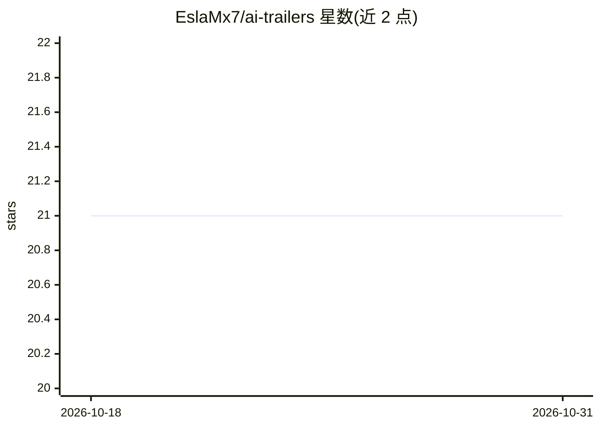

# EslaMx7/ai-trailers

⭐ 21 · TypeScript · MIT · 推送 2026-03-26 · [GitHub](https://github.com/EslaMx7/ai-trailers) · [官网](https://www.npmjs.com/package/ai-trailers) · 个人维护

**把 AI 编程工具的提示词以 git trailer 写入提交信息的工具**

面向使用多种 AI 编程工具的开发者的命令行工具：通过各工具的 hook 事件（如 Claude Code 的 UserPromptSubmit、Gemini 的 BeforeAgent）捕获用户提交的提示词，存入本地 .ai-trailers 文件，在 git commit 时经 commit-msg hook 以标准 git trailer（AI-Tool/AI-Prompt）追加到提交信息，提交后清空缓存。支持 Claude Code、Kiro、Gemini、Codex 四种工具，自动检测并安装 hook；可选附带 UTC 时间戳。README 明确警告提示词将进入 git 历史并对仓库可见者可见，需自行审查敏感信息。依赖 Bun 运行时，通过 bunx 安装。

## 筛选速览

| 维度 | 判定 | 备注 |
|---|---|---|
| AI 角色 | `ai-ecosystem` | LLM/agent 周边工具 |
| 许可风险 | `permissive` | MIT |
| 部署形态 | `None` |  |
| 模型依赖 | locked-api |  |
| 硬件要求 | — | 无带数字的原话,不猜 |
| 安装摩擦 | `low` | 无编译、无系统依赖或容器化 |
| 成熟度 | — | 结构信号不足 |

## 能力要点

- 通过 hook 捕获 AI 工具提示词并存入本地 .ai-trailers 文件
- commit-msg hook 将提示词以标准 git trailer 追加进提交信息
- 支持 Claude Code、Kiro、Gemini、Codex 四种工具并自动检测安装
- 提供 init/install/remove/status/log 命令与可选 UTC 时间戳

## 适用场景

- 在 git 历史中保留指导 AI 修改代码的提示词记录
- PR 审阅时查看代码变更背后的人类意图
- 跨多个 AI 编程工具统一留存提示词上下文

## 场景标签

 · 领域:开发工具/git 工作流

## 证据(README 行号)

> L21: 1. **Capture** — Each AI tool's hook system fires when you submit a prompt. ai-trailers captures it and stores it i
> L22: 2. **Append** — When you commit, a `commit-msg` git hook appends the captured prompts to your commit message as sta
> L65: |Claude Code|`UserPromptSubmit`|`.claude/settings.json`|

## 星数曲线

2026-10-18 21 → 2026-10-31 21（+0）

---
*卡片 v1 · prompt 1.4 · 生成 2026-10-28 · 置信度 high · 依据 README sha `a9dd35fcaffc` · [字段定义](../../DATASET.md)*
