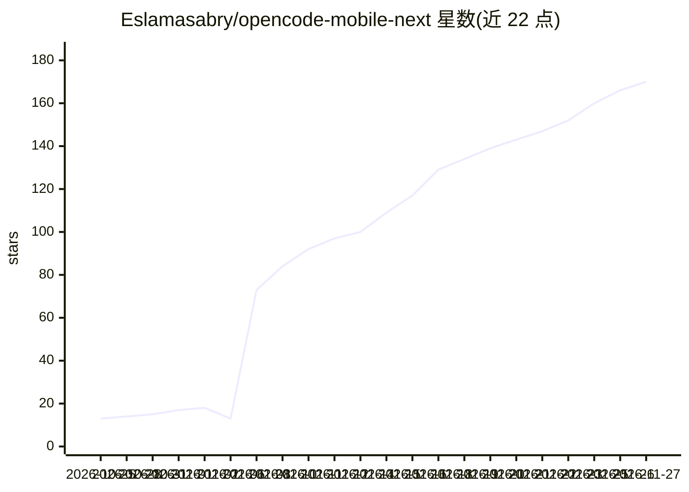

# Eslamasabry/opencode-mobile-next

⭐ 170 · Kotlin · MIT · 推送 2026-11-26 · [GitHub](https://github.com/Eslamasabry/opencode-mobile-next) · [官网](https://eslamasabry.github.io/opencode-mobile-next/) · 个人维护

**在 Android 手机上运行与操控 AI 编码 Agent 的客户端**

Android 客户端应用，提供两种使用方式：内置 Ubuntu Linux 环境在手机上运行 OpenCode 2、Claude Code、Codex 等 Agent（无需 Termux），或通过网络连接并操控电脑上的 Agent 会话。支持命令/编辑审批（聊天、通知、桌面小组件）、任务中途追加指令、切换模型、diff 逐行审阅、Git 提交、内置终端、本地 dev server 预览与定时 prompt。需 Android 8.0+ 64 位设备，手机本地运行模式要求 1,800 MB 内存。

## 筛选速览

| 维度 | 判定 | 备注 |
|---|---|---|
| AI 角色 | `ai-ecosystem` | LLM/agent 周边工具 |
| 许可风险 | `permissive` | MIT |
| 部署形态 | `None` |  |
| 模型依赖 | — | README 未给出锁定关系 |
| 硬件要求 | — | 无带数字的原话,不猜 |
| 安装摩擦 | `medium` | 含编译或系统依赖之一 |
| 成熟度 | — | 结构信号不足 |

## 能力要点

- 内置 Ubuntu Linux 环境，在手机上直接运行多种编码 Agent
- 连接本机电脑并实时操控会话、审批命令与编辑
- diff 审阅、Git 操作、内置终端与本地 dev server 预览
- OpenCode 免费模型无需 API key，语音输入为端侧模型

## 适用场景

- 在 Android 手机上运行编码 Agent 完成修改
- 远程查看并审批电脑上 Agent 的命令与文件编辑
- 移动端逐行审阅 Agent 产生的代码变更并提交 Git

## 场景标签

`编码 Agent` · 领域:编码与开发

## 证据(README 行号)

> L3: An Android app for running and steering AI coding agents on your phone or your own computer.
> L11: - **Run agents on your phone.** Built-in Ubuntu Linux runs OpenCode 2, Claude Code, Codex and more inside the app, 
> L12: - **Connect to your computer.** Pair with OpenCode 2, or connect to Codex or Paseo over your local network or Tails

## 星数曲线

2026-10-25 13 → 2026-11-27 170（+157）

---
*卡片 v1 · prompt 1.4 · 生成 2026-11-27 · 置信度 high · 依据 README sha `dbe9d2d3fb73` · [字段定义](../../DATASET.md)*
