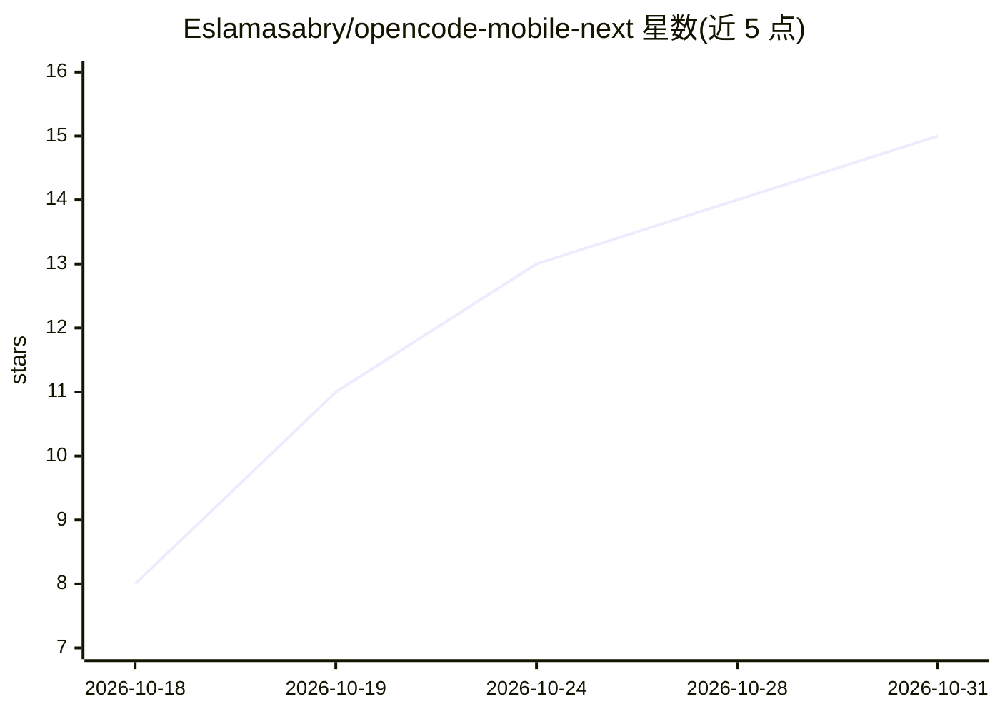

# Eslamasabry/opencode-mobile-next

⭐ 15 · Dart · MIT · 推送 2026-10-30 · [GitHub](https://github.com/Eslamasabry/opencode-mobile-next) · 个人维护

**在 Android 手机上运行编码 agent 的 Flutter 客户端**

Flutter 编写的 Android 应用（含 Kotlin 原生部分），让用户在手机上运行 Claude Code、Codex、Gemini、Kilo、Cline 或 OpenCode 六种编码 agent：应用自行安装带 Git 和 Node 的 Ubuntu 环境跑 agent，无需 Termux；也可通过二维码配对连接电脑上的 agent，提供通知/桌面小组件审批命令、任务中途追加指令、逐行 diff 审查、定时提示词与内置终端。仅支持 OpenCode 2，iOS/macOS 不可用，桌面版为实验性构建。

## 筛选速览

| 维度 | 判定 | 备注 |
|---|---|---|
| AI 角色 | `ai-ecosystem` | LLM/agent 周边工具 |
| 许可风险 | `permissive` | MIT |
| 部署形态 | `None` |  |
| 模型依赖 | — | README 未给出锁定关系 |
| 硬件要求 | — | 无带数字的原话,不猜 |
| 安装摩擦 | `low` | 无编译、无系统依赖或容器化 |
| 成熟度 | `idea` | |

## 能力要点

- 应用内自装 Ubuntu（含 Git/Node）直接在手机上运行编码 agent
- 六种 agent 可选，OpenCode 免费模型无需 API key
- 通知/小组件/聊天三处审批命令，可开启自动批准
- 手机端 diff 逐行审查与应用内 dev server 预览回传截图

## 适用场景

- 在 Android 手机上无电脑运行编码 agent 改代码
- 远程跟随并审批电脑上正在运行的 agent 会话
- 用小组件和定时提示词在后台驱动 agent 任务

## 场景标签

`编码 Agent` · 领域:编码与开发

## 证据(README 行号)

> L27: - **Six agents, one app.** Pick Claude Code, Codex, Gemini, Kilo, Cline or OpenCode for each conversation. OpenCode
> L28: - **Real Linux on the phone.** The app installs its own Ubuntu with Git and Node, runs the agent there, and keeps y
> L56:  - **On my computer:** run `opencode2 pair` on the computer and scan the QR code, or enter its address. Tailscale l

## 星数曲线

2026-10-18 8 → 2026-10-31 15（+7）

---
*卡片 v1 · prompt 1.4 · 生成 2026-10-31 · 置信度 high · 依据 README sha `cd58bb1ba9f9` · [字段定义](../../DATASET.md)*
