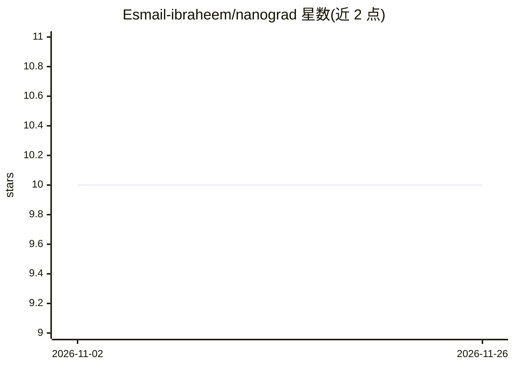

# Esmail-ibraheem/nanograd

⭐ 10 · Python · MIT · 推送 2026-10-25 · [GitHub](https://github.com/Esmail-ibraheem/nanograd) · [官网](https://youtu.be/N8kninEpKTI) · 个人维护

**从零实现 GPT/LLaMA/Stable Diffusion 的神经网络引擎库**

受 micrograd 与 tinygrad 启发的神经网络引擎，提供 Python 库与命令行两种形态，用 PyTorch 风格 API 从零实现 GPT、LLaMA、Stable Diffusion、Vision Transformer 与 BPE 分词器，并包含标量级 autograd 引擎（约 100 行）、张量运算与训练工具。附带 Gradio 图形界面、多模态/RAG 聊天机器人、基于 LLaMA-Factory 的 AutoTrainer（支持阿拉伯语与英语）。运行前需先下载 checkpoints（litgpt 或 ollama 模型），Stable Diffusion 模型从 Hugging Face 下载；API 形态仍在开发中。

## 筛选速览

| 维度 | 判定 | 备注 |
|---|---|---|
| AI 角色 | `ai-native` | 本体是模型或模型工具 |
| 许可风险 | `permissive` | MIT |
| 部署形态 | `library` | 以包/库形式分发 |
| 模型依赖 | local-ok | 支持本地模型 |
| 硬件要求 | — | 无带数字的原话,不猜 |
| 安装摩擦 | `medium` | 含编译或系统依赖之一 |
| 成熟度 | `idea` | |

## 能力要点

- 从零实现 GPT、LLaMA、Stable Diffusion、Vision Transformer 与 BPE 分词器
- 约 100 行代码的标量 autograd 引擎，动态 DAG 反向传播
- CLI 直接运行内置模型（run_gpt/run_llama/run_diffusion 等子命令）
- Gradio 引擎界面集成 RAG 聊天机器人与中英/阿英双语 AutoTrainer

## 适用场景

- 不写代码就通过 CLI 或图形界面运行文本生成与图像生成模型
- 学习 Transformer、autograd 反向传播的从零实现细节
- 对 GPT 类模型做继续预训练与微调
- 搭建 RAG 或多模态聊天机器人

## 场景标签

`聊天机器人` `RAG` `图像生成` `多模态` · 领域:对话与助手

## 证据(README 行号)

> L3: nanograd is a neural net engine (**_command line interface and python library_**) inspired by **micrograd** and **ti
> L35:  Providing a command line interface (CLI) to easily access built-in models without writing any code, making it acce
> L157: |run_gpt|run gpt inference|`nanograd run_gpt`|

## 星数曲线

2026-11-02 10 → 2026-11-26 10（+0）

---
*卡片 v1 · prompt 1.4 · 生成 2026-11-20 · 置信度 high · 依据 README sha `9b4f14d2020d` · [字段定义](../../DATASET.md)*
