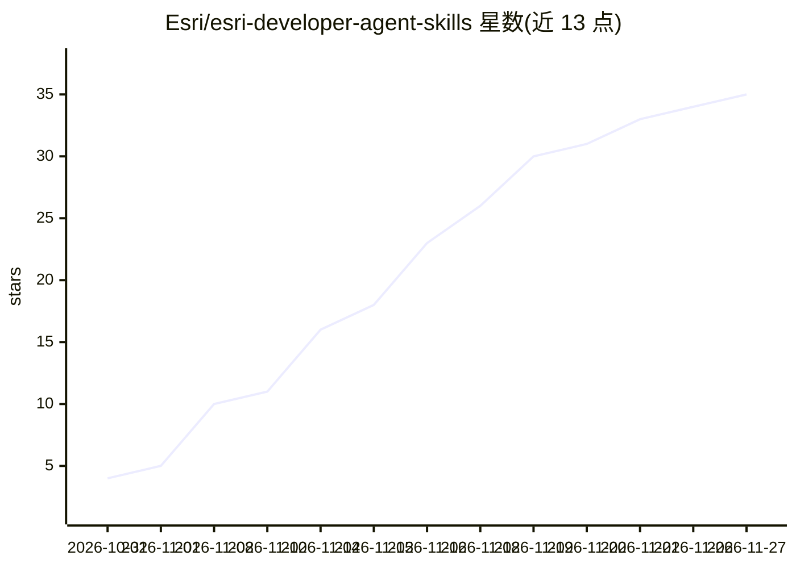

# Esri/esri-developer-agent-skills

⭐ 35 · Apache-2.0 · 推送 2026-11-23 · [GitHub](https://github.com/Esri/esri-developer-agent-skills) · [官网](https://github.com/Esri/esri-agent-skills) · 组织维护

**为 AI agent 提供 ArcGIS 开发技能与官方文档 MCP 服务的插件**

Esri 维护的 agent 插件仓库，包含可安装插件（arcgis-sdks-and-apis-plugin）、按 Agent Plugins 1.0 规范打包的开发技能集，以及 Esri 托管的 MCP 服务器（developers-mcp.arcgis.com）。技能覆盖 ArcGIS 应用需求收集、认证模式及与 CesiumJS、MapLibre、各语言 Maps SDK 等的开发集成，引导 agent 进行 ArcGIS 开发。安装途径为 marketplace 插件方式或 npx skills add 命令，兼容 GitHub Copilot CLI、VS Code、Claude Code、Cursor 等客户端。

## 筛选速览

| 维度 | 判定 | 备注 |
|---|---|---|
| AI 角色 | `ai-ecosystem` | LLM/agent 周边工具 |
| 许可风险 | `permissive` | Apache-2.0 |
| 部署形态 | `library` | 以包/库形式分发 |
| 模型依赖 | — | README 未给出锁定关系 |
| 硬件要求 | — | 无带数字的原话,不猜 |
| 安装摩擦 | `low` | 无编译、无系统依赖或容器化 |
| 成熟度 | — | 结构信号不足 |

## 能力要点

- 包含技能集与 Esri 托管的开发文档 MCP 服务器
- 符合 Agent Plugins 1.0 规范的插件打包
- 覆盖 16 项开发技能（认证、需求、13 个 SDK/API 集成等）
- npx skills add 命令行安装选定技能

## 适用场景

- 让 AI agent 按照 ArcGIS 官方模式完成开发任务
- 通过 MCP 服务器检索 ArcGIS 官方开发者文档
- 在 Copilot CLI、Claude Code、Cursor 等客户端中使用 ArcGIS 技能

## 场景标签

 · 领域:GIS/开发者工具

## 证据(README 行号)

> L3: Esri Developer Agent Skills provides an installable plugin, reusable skills, and an Esri-hosted MCP server for offic
> L15: - **Esri MCP server for developer documentation** (`esri-mcp-server-for-developer-documentation`): Esri-hosted MCP 

## 星数曲线

2026-10-31 4 → 2026-11-27 35（+31）

---
*卡片 v1 · prompt 1.4 · 生成 2026-11-18 · 置信度 high · 依据 README sha `4b762894b090` · [字段定义](../../DATASET.md)*
