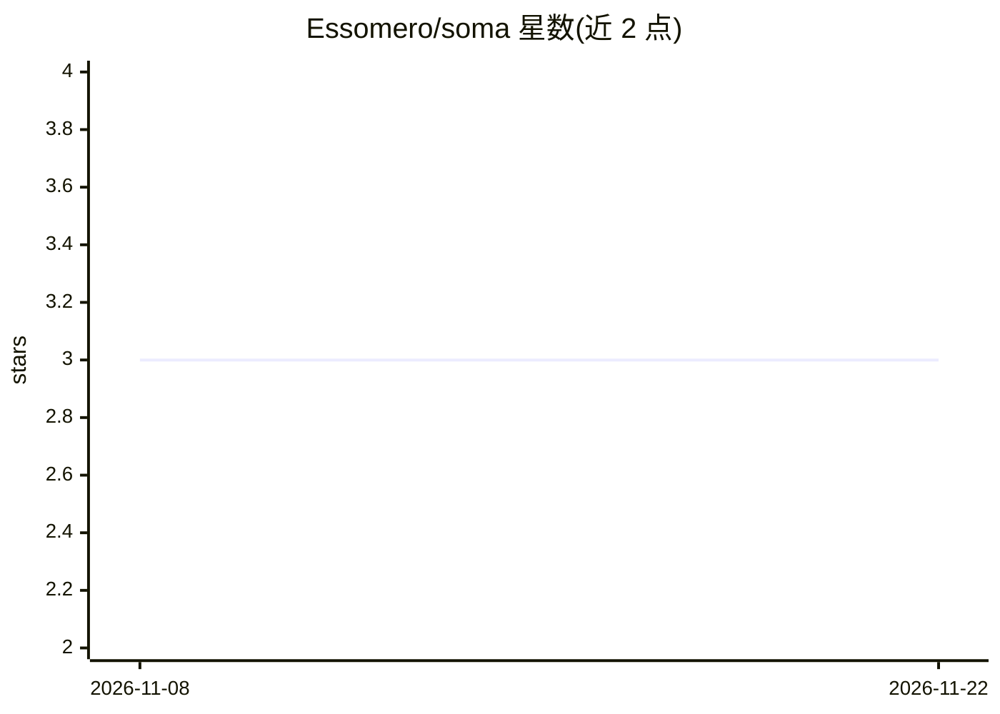

# Essomero/soma

⭐ 3 · TypeScript · 推送 2026-11-19 · [GitHub](https://github.com/Essomero/soma) · [官网](https://soma.mayanja.dev/featured/why-i-built-soma) · 个人维护

**自托管的 AI 加速个人学习与发布平台**

Soma 是一个部署在自己基础设施上的学习、写作与发布平台，以 Markdown 为内容格式，渲染 KaTeX 数学、Mermaid 图、交互式 3D 场景与可运行代码块。仓库附带 agent skill 与内容 MCP server（13 个 stdio 工具），指向任意 LLM 或编码 agent 即可自动创建、编辑与发布内容；阅读体验内含划选段落的 margin AI 解释与多 provider 模型网关。数据默认私密，存储在 SQLite/Turso 上，支持 Docker、Fly.io、Railway、Render、Vercel 等多种部署方式。配套可选的 Son 语音问答 agent 在本地运行 TTS 与语音识别。

## 筛选速览

| 维度 | 判定 | 备注 |
|---|---|---|
| AI 角色 | `ai-native` | 本体是模型或模型工具 |
| 许可风险 | `none` | — |
| 部署形态 | `self-host` | docker 或自建部署 |
| 模型依赖 | — | README 未给出锁定关系 |
| 硬件要求 | — | 无带数字的原话,不猜 |
| 安装摩擦 | `low` | 无编译、无系统依赖或容器化 |
| 成熟度 | — | 结构信号不足 |

## 能力要点

- 附带 agent skill 与内容 MCP server（13 个 stdio 工具），agent 可自动起草、校验、发布内容
- 阅读体验内置划选段落调用 AI 解释/简化/质疑的 margin AI
- 支持 OpenRouter、DeepSeek、Gemini、Groq、Cerebras 多 provider 模型网关
- 12 种内容块类型渲染：KaTeX、Mermaid、3D 场景、可运行代码等

## 适用场景

- 在自托管平台上集中管理书籍、课程、笔记并随处阅读
- 让编码 agent 自动把现有书籍或文章转换为平台页面
- 用语音完成技术口头测试（可选的 Son 组件）

## 场景标签

`知识库管理` · 领域:知识与检索

## 证据(README 行号)

> L15: Soma is one centralized place to learn. AI-accelerated learning you own, that works with whatever you're already us
> L65: - **Inline margin AI**: Select any paragraph, derivation, or code snippet to ask an AI model to explain, challenge,

## 星数曲线

2026-11-08 3 → 2026-11-22 3（+0）

---
*卡片 v1 · prompt 1.4 · 生成 2026-11-22 · 置信度 mid · 依据 README sha `a5dacfc3af3d` · [字段定义](../../DATASET.md)*
