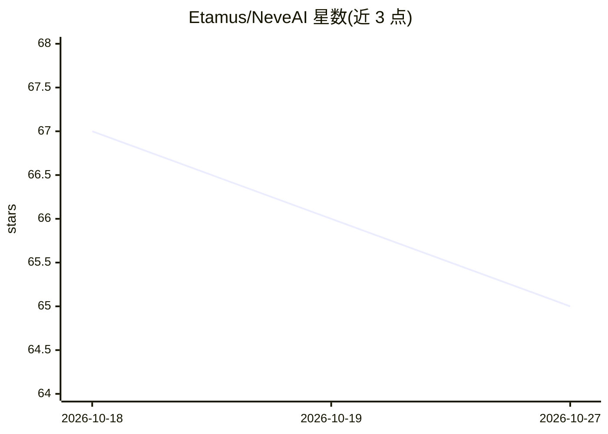

# Etamus/NeveAI

⭐ 65 · Python · NOASSERTION · 推送 2026-10-24 · [GitHub](https://github.com/Etamus/NeveAI) · [官网](https://huggingface.co/NeveAI) · 个人维护

**本地隐私优先的 AI 平台：离线运行 LLM 对话、生成图像/音乐/视频**

面向终端用户的本地 AI 生态平台：FastAPI 后端 + SvelteKit 5 前端，内嵌 llama.cpp 运行 GGUF 模型，支持 CUDA/Vulkan 硬件加速。功能包括流式聊天、多模态视觉（mmproj 自动检测）、基于 ChromaDB 的 RAG（混合 BM25+语义检索、OCR、本地 embeddings）、本地图像生成（Neve Image 系列）、音乐与视频生成、Pyodide 浏览器内 Python 执行、文档生成及 MCP v1.26 外部工具。通过 instalar.bat 安装（自动检测 GPU 并下载 llama.cpp 二进制），主要支持 Windows，Linux/macOS 需自行适配。

## 筛选速览

| 维度 | 判定 | 备注 |
|---|---|---|
| AI 角色 | `ai-native` | 本体是模型或模型工具 |
| 许可风险 | `none` | NOASSERTION |
| 部署形态 | `library` | 以包/库形式分发 |
| 模型依赖 | local-ok | 支持本地模型 |
| 硬件要求 | — | 无带数字的原话,不猜 |
| 安装摩擦 | `medium` | 含编译或系统依赖之一 |
| 成熟度 | — | 结构信号不足 |

## 能力要点

- 内嵌 llama.cpp 运行 GGUF 模型，GPU 自动检测（CUDA/HIP/Vulkan/CPU）
- RAG：ChromaDB 向量库 + BM25/语义混合检索 + OCR + 本地 embeddings
- 本地图像/音乐/视频生成（Neve Image、Neve-Step、Neve Video）
- MCP v1.26 外部工具与 Pyodide 浏览器内 Python 执行

## 适用场景

- 在本地离线与 LLM 对话、处理文档与知识库问答
- 不依赖外部 API 生成图像、音乐与视频
- 通过 MCP 接入外部工具扩展 AI 能力

## 场景标签

`聊天机器人` `图像生成` `视频生成` `文档问答` · 领域:对话与助手

## 证据(README 行号)

> L3: **NeveAI** é um ecossistema local de orquestração de IA privacy-first, desenvolvido para oferecer uma experiência de
> L145: - **Geração e edição de imagens local** com Neve Image 1.5 (estilos e resoluções selecionáveis), Neve Image 2 (Com

## 星数曲线

2026-10-18 67 → 2026-10-27 65（-2）

---
*卡片 v1 · prompt 1.4 · 生成 2026-10-24 · 置信度 mid · 依据 README sha `09943d205125` · [字段定义](../../DATASET.md)*
