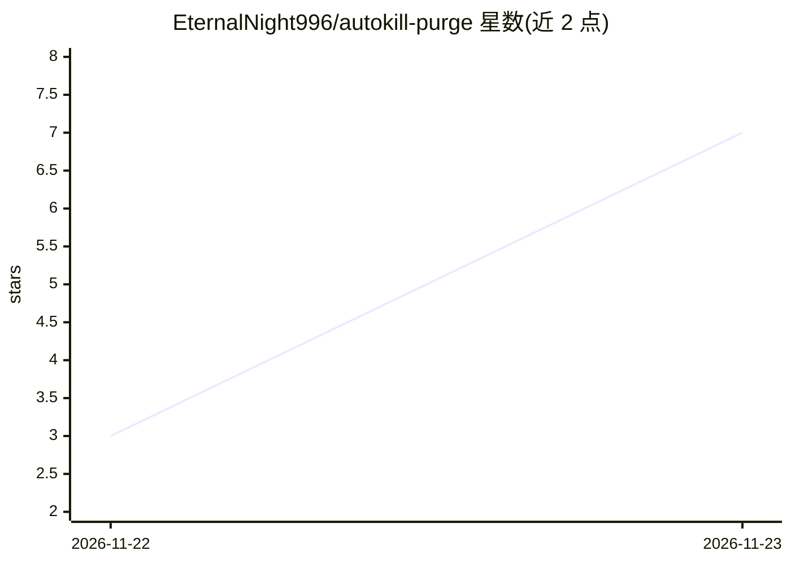

# EternalNight996/autokill-purge

⭐ 7 · JavaScript · NOASSERTION · 推送 2026-11-22 · [GitHub](https://github.com/EternalNight996/autokill-purge) · [官网](https://www.npmjs.com/package/autokill-purge) · 个人维护 · 中文 README

**面向 DSH/MengBot/AutoKill 三宿主的补丁控制台**

一个 Node 命令行 + Web 控制台，针对三个宿主（DeepSeek Harness、MengBot、AutoKill）提供 83 条宿主补丁的可视化勾选与回滚、提示词注入文件写入、装备/预设发放、备份与还原、一键安装/卸载及残留验收。Windows 支持完整（asar 落地、WMI 结束进程树、启动项），macOS/Linux 提供基础补丁能力。零依赖，仅用 Node 标准库，补丁引擎 vendor 自上游 dsh-purge，作者声明面向自己拥有的机器与宿主，并注明不改动模型厂商服务端审核。

## 筛选速览

| 维度 | 判定 | 备注 |
|---|---|---|
| AI 角色 | `ai-ecosystem` | LLM/agent 周边工具 |
| 许可风险 | `none` | NOASSERTION |
| 部署形态 | `library` | 以包/库形式分发 |
| 模型依赖 | locked-api |  |
| 硬件要求 | — | 无带数字的原话,不猜 |
| 安装摩擦 | `low` | 无编译、无系统依赖或容器化 |
| 成熟度 | — | 结构信号不足 |

## 能力要点

- 83 条宿主补丁可视化勾选、字节替换与回滚
- 全量备份（含 sha256 清单）与 verify 残留验收
- 零依赖 Node 实现，npx 一行安装
- 跨平台差异集中在 web/platform.mjs，Windows 完整、macOS/Linux 基础

## 适用场景

- 对本地 DSH 宿主批量应用/回滚补丁
- 安装前用 --dry-run 查看改动计划
- 卸载后用 verify 确认宿主目录已还原

## 场景标签

 · 领域:LLM 工具/宿主修改

## 证据(README 行号)

> L5:  三宿主（DSH / MengBot / AutoKill）的破甲控制台 —— 83 条宿主补丁可视化 · 载荷生成 · 装备发放 · 备份还原 · 一键装/卸
> L47: |提示词层|宿主往 system prompt 里塞的「安全边界 / 拒答话术 / 身份句」|**83 条宿主补丁**逐条字节替换（可视化勾选、可回滚）|
> L123: |**DeepSeek Harness**|@deepseek-ai · deepseek-harness|宿主本体（0.1.7 / 0.2.2 两代布局差异是兼容层的工作对象）|

## 星数曲线

2026-11-22 3 → 2026-11-23 7（+4）

---
*卡片 v1 · prompt 1.4 · 生成 2026-11-22 · 置信度 high · 依据 README sha `7a465ebb3974` · [字段定义](../../DATASET.md)*
