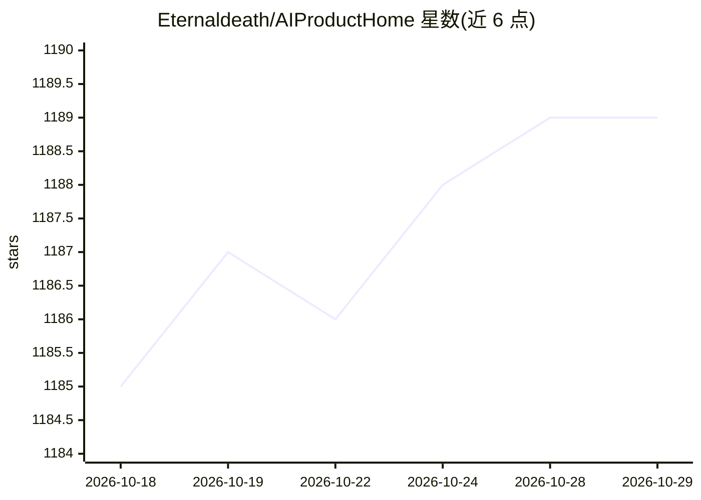

# Eternaldeath/AIProductHome

⭐ 1,189 · 推送 2026-10-18 · [GitHub](https://github.com/Eternaldeath/AIProductHome) · [官网](https://eternaldeath.github.io/AIProductHome/) · 个人维护 · 中文 README

**AI 工具与产品索引清单：分类收录并标注免费/付费等信息**

以 README 表格形式维护的 AI 产品导航清单，按搜索引擎、底层模型、单/多模型聊天应用、行业大模型、开发框架、MCP、AI 助手、代码辅助、AI IDE、图像/视频生成、PPT 等 20 余个类别组织条目。每个条目标注免费/付费、开源、需科学上网、测试阶段等图标信息，并附推荐理由。通过 GitHub Pages 提供在线网站，收录排序为广告商工具→大型商业工具→按时间排列，用户可通过提交 ISSUE 自荐或纠错。

## 筛选速览

| 维度 | 判定 | 备注 |
|---|---|---|
| AI 角色 | `ai-knowledge` | 知识聚合/清单类 |
| 许可风险 | `none` | — |
| 部署形态 | `None` |  |
| 模型依赖 | — | README 未给出锁定关系 |
| 硬件要求 | — | 无带数字的原话,不猜 |
| 安装摩擦 | `low` | 无编译、无系统依赖或容器化 |
| 成熟度 | — | 结构信号不足 |

## 能力要点

- 按 20 余个类别组织的 AI 产品表格索引
- 条目标注免费/付费、开源、科学上网等图标信息
- 提供 GitHub Pages 在线网站与国内外镜像仓库
- 支持通过 ISSUE 自荐、纠错与资源更新

## 适用场景

- 按分类查找和比较各类 AI 工具与产品
- 了解免费/付费与开源属性等关键信息
- 发现国内可用的 AI 产品与中转 API 服务

## 场景标签

`精选清单` · 领域:学习与行业

## 证据(README 行号)

> L3: > 🤖 发现优质 AI 产品的一站式索引 —— 收录 · 筛选 · 推荐
> L41: |产品名称|相关信息|备注|

## 星数曲线

2026-10-18 1,185 → 2026-10-29 1,189（+4）

---
*卡片 v1 · prompt 1.4 · 生成 2026-10-21 · 置信度 high · 依据 README sha `2fa3b7b7479a` · [字段定义](../../DATASET.md)*
