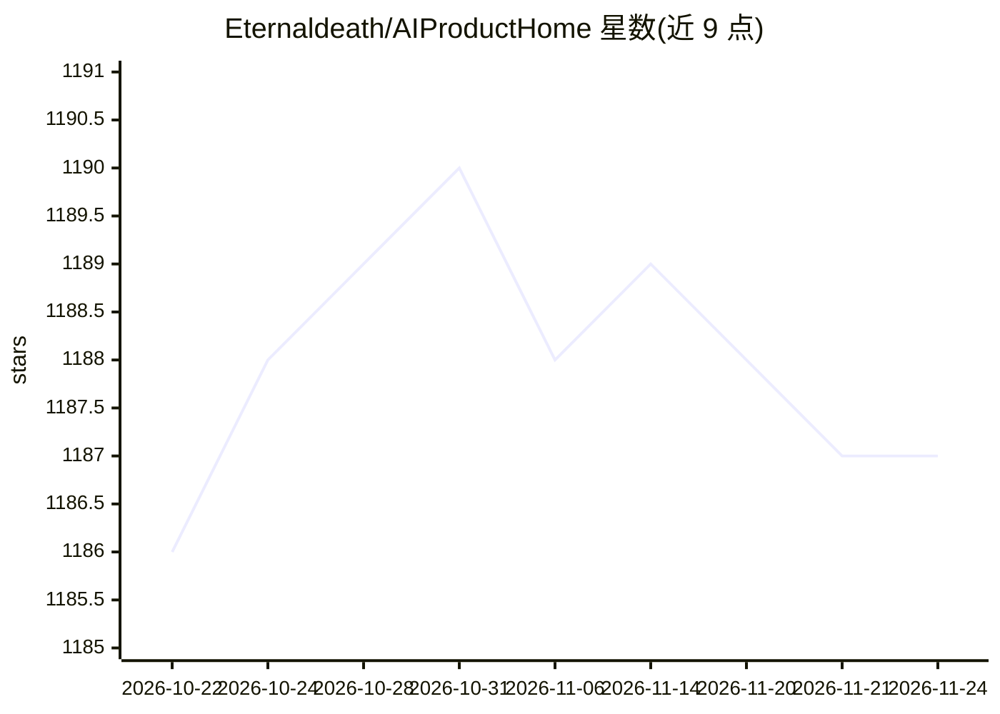

# Eternaldeath/AIProductHome

⭐ — · [GitHub]() · 个人维护 · 中文 README

**AI 产品一站式索引：收录、分类并标注各类 AI 工具**

以 Markdown 表格组织的 AI 产品目录仓库，按中转站、充值平台、搜索引擎、底层模型、单/多模型聊天应用、行业大模型、模型开发框架、MCP、AI 助手、代码辅助、AI IDE、AI 浏览器、艺术创作（图像/视频/角色扮演）等类别收录条目，并为每条标注测试阶段、科学上网、免费/付费、开源等图标属性。提供 GitHub Pages 在线网站与国内镜像仓库，支持通过 Issue 自我推荐、纠错与报告失效资源，排序策略含广告位与商业工具优先规则。仓库本身不提供安装或运行环节。

## 筛选速览

| 维度 | 判定 | 备注 |
|---|---|---|
| AI 角色 | `ai-knowledge` | 知识聚合/清单类 |
| 许可风险 | `none` | — |
| 部署形态 | `None` |  |
| 模型依赖 | — | README 未给出锁定关系 |
| 硬件要求 | — | 无带数字的原话,不猜 |
| 安装摩擦 | `low` | 无编译、无系统依赖或容器化 |
| 成熟度 | — | 结构信号不足 |

## 能力要点

- 按 15+ 类别组织的 AI 产品收录表
- 免费/付费/开源/需科学上网等图标标注体系
- 支持 Issue 自我推荐、纠错与失效资源报告
- 提供在线网站与国内仓库双入口

## 适用场景

- 查找某一类别下的 AI 工具选项
- 了解国内可用的 AI 产品与中转服务
- 在收录目录中提交自己的 AI 产品

## 场景标签

`精选清单` · 领域:学习与行业

## 证据(README 行号)

> L3: > 🤖 发现优质 AI 产品的一站式索引 —— 收录 · 筛选 · 推荐
> L49: |产品名称|相关信息|备注|
> L108: # 底层模型

## 星数曲线

2026-10-22 1,186 → 2026-11-24 1,187（+1）

---
*卡片 v1 · prompt 1.4 · 生成 2026-11-23 · 置信度 high · 依据 README sha `922f1d4530f9` · [字段定义](../../DATASET.md)*
