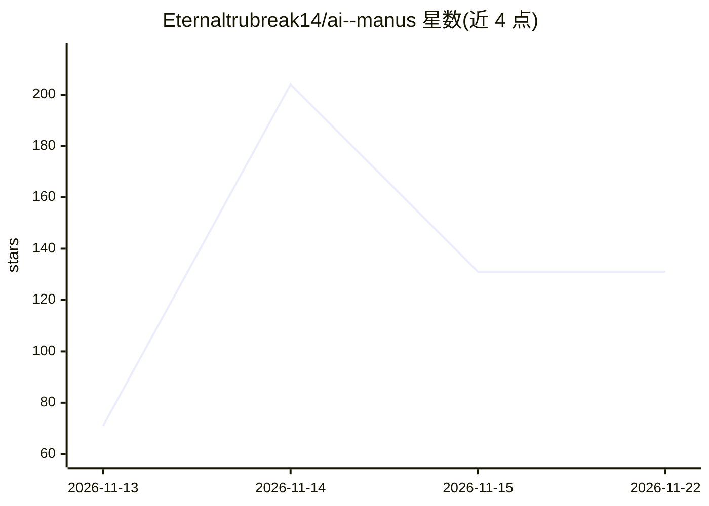

# Eternaltrubreak14/ai--manus

⭐ 131 · Apache-2.0 · 推送 2026-11-15 · [GitHub](https://github.com/Eternaltrubreak14/ai--manus) · 个人维护

**面向个人用户的自主 AI Agent：代跑代码与操作浏览器**

README 以功能介绍为主描述一个名为 Manus 的自主 AI Agent：接受自然语言指令后自主编写并执行脚本、控制浏览器（导航、填表、采集信息），完成多步骤任务，可在后台作为个人助理运行。定位为家庭、学习与轻量办公场景的辅助工具，非企业平台。README 给出硬件兼容表（最低 4 GB 内存、双核 CPU）与上手步骤说明，但未提供安装命令、架构说明或代码入口。

## 筛选速览

| 维度 | 判定 | 备注 |
|---|---|---|
| AI 角色 | `ai-native` | 本体是模型或模型工具 |
| 许可风险 | `permissive` | Apache-2.0 |
| 部署形态 | `None` |  |
| 模型依赖 | — | README 未给出锁定关系 |
| 硬件要求 | — | 无带数字的原话,不猜 |
| 安装摩擦 | `low` | 无编译、无系统依赖或容器化 |
| 成熟度 | — | 结构信号不足 |

## 能力要点

- 自主编写并执行代码完成任务
- 浏览器控制：导航、填表、信息采集
- 脚本与浏览器操作可在同一任务流中衔接
- 后台常驻的个人助理模式

## 适用场景

- 让学生整理研究笔记、跑小脚本
- 让 agent 代为填写重复表单、采集多页面信息
- 日常小任务的自动化委派

## 场景标签

`AI 助手` `浏览器自动化` · 领域:效率与自动化

## 证据(README 行号)

> L10: - **Autonomous Code Execution:** Manus AI agent runs code on its own to complete tasks, so you can focus on decisio
> L18: Manus is an autonomous AI agent designed to run code and control a browser on your behalf. Instead of acting like a

## 星数曲线

2026-11-13 71 → 2026-11-22 131（+60）

---
*卡片 v1 · prompt 1.4 · 生成 2026-11-17 · 置信度 low · 依据 README sha `0f78ee3a5dd2` · [字段定义](../../DATASET.md)*
