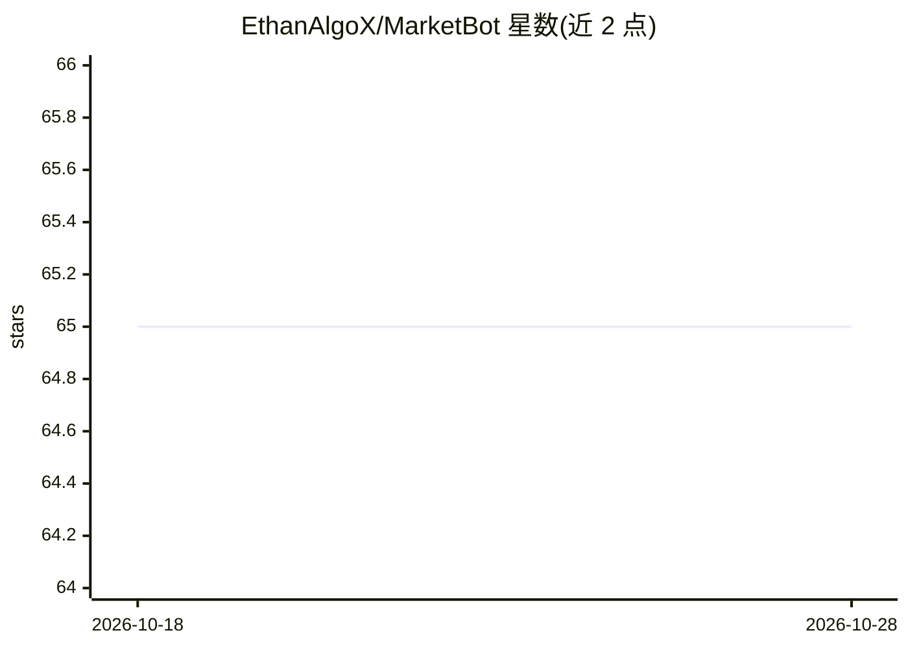

# EthanAlgoX/MarketBot

⭐ 65 · TypeScript · Apache-2.0 · 推送 2026-10-13 · [GitHub](https://github.com/EthanAlgoX/MarketBot) · 个人维护 · 中文 README

**面向股票与加密交易者的个人金融情报工作台**

MarketBot 是面向股票与加密货币交易者的个人工作台，提供 Web、Electron 桌面与 Expo 手机多端入口，配套独立 AI-Stock 服务负责金融数据与模拟账本。助手负责订阅情报、每日归档与通知；当前已实现登录、私有金融工作区、自选维护、CSV 交易导入、RSS/Atom 订阅与三个 BTC 日线模拟规则。项目声明已进入开发实施阶段，模型研究与真实通知需单独验收，不接入真实资金。从源码运行，需 Python 引导脚本。

## 筛选速览

| 维度 | 判定 | 备注 |
|---|---|---|
| AI 角色 | `ai-native` | 本体是模型或模型工具 |
| 许可风险 | `permissive` | Apache-2.0 |
| 部署形态 | `None` |  |
| 模型依赖 | — | README 未给出锁定关系 |
| 硬件要求 | — | 无带数字的原话,不猜 |
| 安装摩擦 | `low` | 无编译、无系统依赖或容器化 |
| 成熟度 | `idea` | |

## 能力要点

- Web/Electron/Expo 三端入口，共享服务端记录
- 金融数据与唯一模拟账本由独立 AI-Stock 服务负责
- RSS/Atom 订阅、每日归档与站内通知
- 三个内置加密货币日线模拟规则已通过真实 BTC 行情验收

## 适用场景

- 维护自选与手工账户，CSV 模板导入交易记录并查重
- 订阅 RSS/Atom 情报来源并接收每日归档与通知
- 在模拟账本上运行 BTC 日线模拟规则做决策参考

## 场景标签

`金融量化` · 领域:学习与行业

## 证据(README 行号)

> L3: 面向股票与加密货币交易者的个人工作台。MarketBot 提供 Web、Electron 与 Expo 手机入口；独立 AI-Stock 服务负责金融数据与唯一模拟账本。助手负责订阅情报、每日归档和通知。
> L5: 已进入开发实施。当前可用的是登录、私有金融工作区、自选维护、手工账户与模板交易导入，以及 RSS/Atom 来源、订阅样例预览、主题推荐、关联来源候选、日报快照、更正、反馈和站内通知。三个内置加密货币日线模拟规则已通过真实 BTC 

## 星数曲线

2026-10-18 65 → 2026-10-28 65（+0）

---
*卡片 v1 · prompt 1.4 · 生成 2026-10-24 · 置信度 mid · 依据 README sha `4a16b1761616` · [字段定义](../../DATASET.md)*
