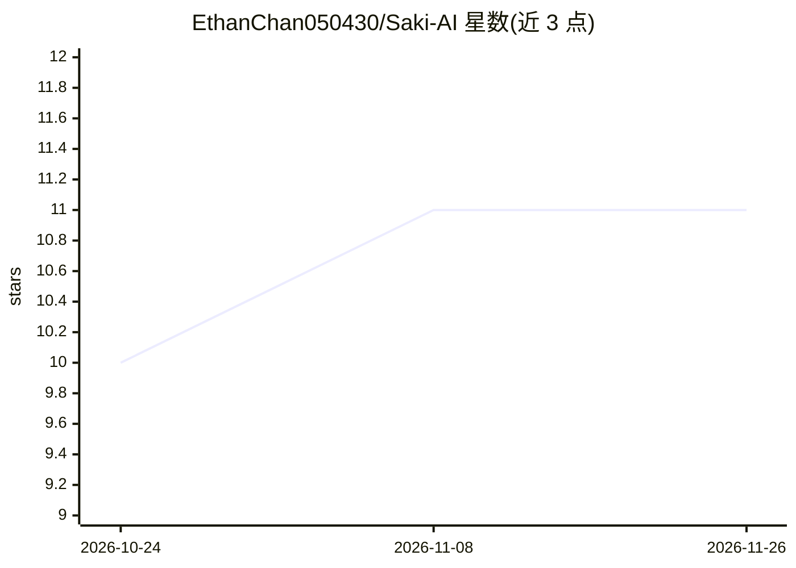

# EthanChan050430/Saki-AI

⭐ 11 · JavaScript · Apache-2.0 · 推送 2026-11-25 · [GitHub](https://github.com/EthanChan050430/Saki-AI) · 个人维护 · 中文 README

**开源本地优先的 AI Agent 个人工作区：代码/文件/研究一体 GUI**

在本地机器上运行的 AI agent 工作区，通过一个 GUI 连接本地模型（Ollama、LM Studio）与云端 API（OpenAI、Claude、Gemini、DeepSeek、Qwen 等），由 agent 执行读写文件、运行终端命令、深度研究、生成文档与 PPT 等任务。关键机制包括每回合自动文件快照（无需 Git 即可回滚）、跨会话长期记忆、MCP/插件/Skills 扩展市场，以及语音与视频通话交互。以单进程、单端口本地 Web 服务形式运行，数据存于本地 JSON 文件；Windows 提供便携版，macOS/Linux 可从源码启动。安全上仅提供应用级审批与路径检查，非 OS 沙箱。

## 筛选速览

| 维度 | 判定 | 备注 |
|---|---|---|
| AI 角色 | `ai-native` | 本体是模型或模型工具 |
| 许可风险 | `permissive` | Apache-2.0 |
| 部署形态 | `desktop` | 安装包/桌面程序 |
| 模型依赖 | local-ok | 支持本地模型 |
| 硬件要求 | — | 无带数字的原话,不猜 |
| 安装摩擦 | `low` | 无编译、无系统依赖或容器化 |
| 成熟度 | — | 结构信号不足 |

## 能力要点

- 每回合工作区快照回滚，无需 Git
- 多模型接入：Ollama、LM Studio、OpenAI-compatible 端点等
- MCP 工具、Skills 与插件市场一键安装
- PDF/Office 问答、多源深度研究、PPT 生成导出

## 适用场景

- 在本地仓库里让 agent 读写文件并运行终端命令改代码
- 不装 Git 也能对 agent 的每步改动随时回滚
- 用本地模型或各家云 API 做多源深度研究与 PPT 生成
- 通过插件市场给 agent 加 MCP 工具和自定义技能

## 场景标签

`AI 助手` `编码 Agent` `Agent 记忆` `模型网关` · 领域:Agent 开发

## 证据(README 行号)

> L16: **Saki AI is an open-source, local-first AI workspace that runs on your machine.** Connect local models (Ollama, LM
> L50: - **Any model**: Ollama, LM Studio, OpenAI, Anthropic, Gemini, DeepSeek, Zhipu, Kimi, Qwen, Doubao, MiniMax, or any
> L63: **Windows portable**: download `Saki-AI-3.0-win-x64.zip`, unzip, run `Saki-AI.exe`. Your browser opens http://127.0

## 星数曲线

2026-10-24 10 → 2026-11-26 11（+1）

---
*卡片 v1 · prompt 1.4 · 生成 2026-11-19 · 置信度 high · 依据 README sha `4d27d0494cae` · [字段定义](../../DATASET.md)*
