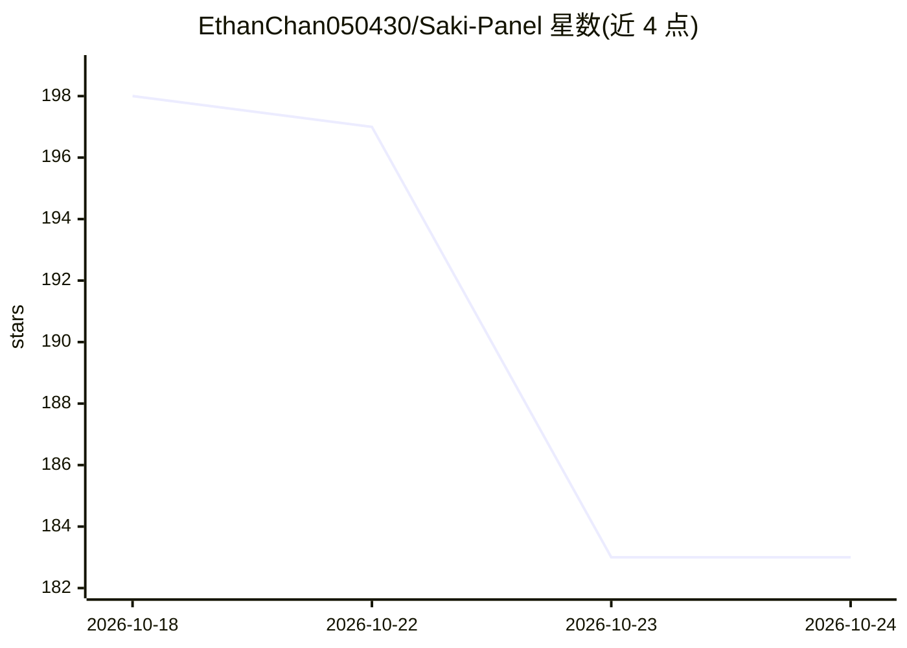

# EthanChan050430/Saki-Panel

⭐ 184 · TypeScript · Apache-2.0 · 推送 2026-10-23 · [GitHub](https://github.com/EthanChan050430/Saki-Panel) · [官网](https://dreamstarry.top:5478/) · 个人维护 · 中文 README

**带 AI SRE 助手的服务器运维面板：日志诊断与自愈**

基于 React/Fastify 的开源服务器运维面板（Web + Panel API + 每节点 Daemon 架构），通过 SSH 连接远程 Linux 节点，管理 Minecraft、Steam、Docker 容器与 Compose 等 9 类实例。内嵌 Saki AI 助手读取日志、文件与节点指标做事件诊断，支持 Skills、MCP、图片/日志附件；Saki Watch 记录异常退出与错误指纹，补丁默认需人工批准，验证失败时在满足条件下回滚。模型可用本地 Ollama/LM Studio 或云端。提供源码运行与 Docker Compose 预构建镜像两种部署方式。

## 筛选速览

| 维度 | 判定 | 备注 |
|---|---|---|
| AI 角色 | `ai-enhanced` | 去掉 AI 部分产品仍成立 |
| 许可风险 | `permissive` | Apache-2.0 |
| 部署形态 | `self-host` | docker 或自建部署 |
| 模型依赖 | local-ok | 支持本地模型 |
| 硬件要求 | — | 无带数字的原话,不猜 |
| 安装摩擦 | `low` | 无编译、无系统依赖或容器化 |
| 成熟度 | — | 结构信号不足 |

## 能力要点

- Saki 助手读取实例状态/日志/文件/指标，操作带风险级别与人工批准
- Saki Watch：异常退出诊断、补丁验证失败自动回滚、冷却与升级提醒
- 9 类实例管理（Minecraft/Steam/Docker/Compose 等）+ Web 终端、Git 可视化、多数据库
- 支持本地 Ollama / LM Studio 推理，模型请求保留在本地端点

## 适用场景

- 在统一 Web 控制台管理游戏服务器、Docker 容器与普通进程
- 崩溃后让 AI 读取日志诊断根因并给出补丁建议
- 运维多台远程 Linux 节点并做角色权限与审计管理

## 场景标签

 · 领域:运维/DevOps 面板

## 证据(README 行号)

> L5: **An open-source server operations panel with AI in the workspace.**
> L40: Saki can use local Ollama or LM Studio models, or a cloud provider configured in Settings. Local inference keeps mo

## 星数曲线

2026-10-18 198 → 2026-10-24 183（-15）

---
*卡片 v1 · prompt 1.4 · 生成 2026-10-22 · 置信度 high · 依据 README sha `04251680eab4` · [字段定义](../../DATASET.md)*
