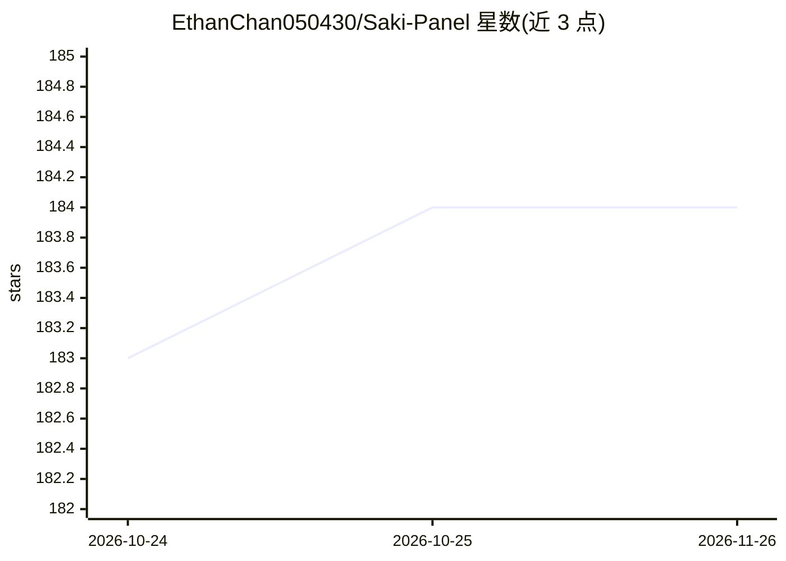

# EthanChan050430/Saki-Panel

⭐ 184 · TypeScript · Apache-2.0 · 推送 2026-11-19 · [GitHub](https://github.com/EthanChan050430/Saki-Panel) · [官网](https://dreamstarry.top/saki-panel/) · 个人维护 · 中文 README

**面向运维/homelab 用户的服务器面板，内置 SRE Agent 辅助诊断**

一个开源服务器运维面板，通过 Web 控制台管理 Minecraft、Steam、Docker 容器与 Compose 等九种实例类型，覆盖远程 Linux 节点 SSH 接入、终端、文件、数据库、定时任务、Git 可视化与角色权限。AI 部分包括工作区内 Agent（读写文件、管理实例、执行限定命令，支持 Skills/MCP/附件）、Saki Watch 事件诊断机制：记录崩溃指纹、按需 AI 诊断、补丁需人工审批、验证失败时可回滚。Agent 任务可超 400 轮并自动压缩上下文，可设预算。源码或 Docker 部署，需 Node.js ≥ 22.13。

## 筛选速览

| 维度 | 判定 | 备注 |
|---|---|---|
| AI 角色 | `ai-enhanced` | 去掉 AI 部分产品仍成立 |
| 许可风险 | `permissive` | Apache-2.0 |
| 部署形态 | `self-host` | docker 或自建部署 |
| 模型依赖 | local-ok | 支持本地模型 |
| 硬件要求 | — | 无带数字的原话,不猜 |
| 安装摩擦 | `low` | 无编译、无系统依赖或容器化 |
| 成熟度 | — | 结构信号不足 |

## 能力要点

- Saki Watch 崩溃自愈流程：指纹记录、AI 诊断、审批式补丁、验证失败回滚
- 工作区 Agent 支持 Skills 与 MCP，可附加截图与日志文件
- 九种实例类型管理，含 Minecraft、Steam 与 Docker Compose
- 支持本地 Ollama/LM Studio 模型或云端模型

## 适用场景

- homelab 里统一管理 Minecraft 服务器和 Docker 容器
- 服务崩溃后让 AI 读日志诊断并给出补丁 diff 审批
- 通过 SSH 面板管理多台远程 Linux 节点
- 断网/内网环境下用本地模型做运维问答

## 场景标签

 · 领域:运维/DevOps 工具

## 证据(README 行号)

> L7: Manage Minecraft, Steam, Docker, and ordinary processes from one web console. Saki uses live logs, files, and node m
> L45: |**AI-assisted operations**|Ask about status and logs, inspect or edit workspace files, manage instances, and run s
> L113: Instance types: `generic_command`, `nodejs`, `python`, `java_jar`, `shell_script`, `docker_container`, `docker_com

## 星数曲线

2026-10-24 183 → 2026-11-26 184（+1）

---
*卡片 v1 · prompt 1.4 · 生成 2026-11-26 · 置信度 high · 依据 README sha `6fe55fc7232a` · [字段定义](../../DATASET.md)*
