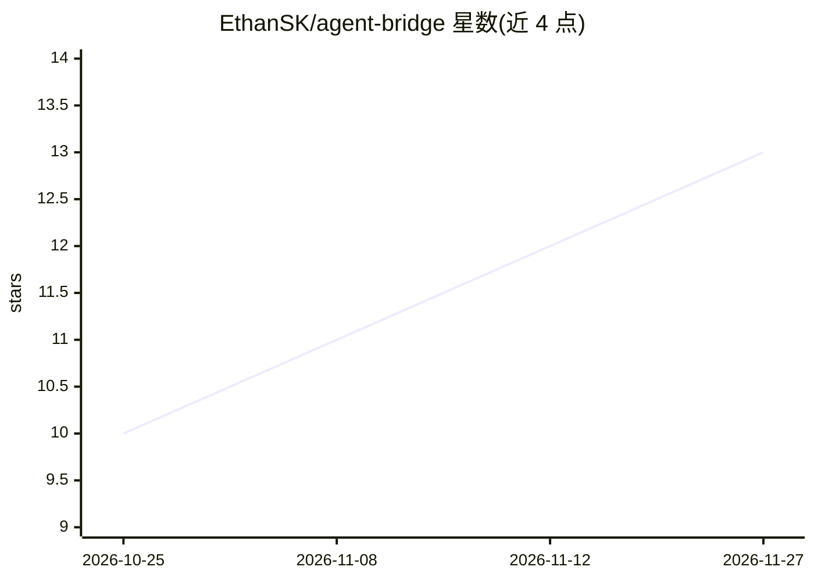

# EthanSK/agent-bridge

⭐ 13 · JavaScript · NOASSERTION · 推送 2026-11-25 · [GitHub](https://github.com/EthanSK/agent-bridge) · [官网](https://ethansk.github.io/agent-bridge/) · 个人维护

**让多台机器上的 AI agent 会话通过 SSH 互通消息**

agent-bridge 让运行中的 agent harness 会话（Claude Code、OpenClaw、Codex 等）跨机器点对点通信：通过 SSH 与本地 inbox 投递消息，无云端中继，配置、密钥与日志都留在用户自己的机器上。提供 MCP 工具（bridge_*）与各 harness 的 channel 插件，支持具名路由、远程 shell 诊断、macOS 通知推送，以及全机队共享的 learnings 上下文库（append-only NDJSON，SSH 复制、离线后双向 sync）。传输面仅依赖 bash/ssh 与 Node，明确不使用 Docker。

## 筛选速览

| 维度 | 判定 | 备注 |
|---|---|---|
| AI 角色 | `ai-ecosystem` | LLM/agent 周边工具 |
| 许可风险 | `none` | NOASSERTION |
| 部署形态 | `desktop` | 安装包/桌面程序 |
| 模型依赖 | — | README 未给出锁定关系 |
| 硬件要求 | — | 无带数字的原话,不猜 |
| 安装摩擦 | `low` | 无编译、无系统依赖或容器化 |
| 成熟度 | — | 结构信号不足 |

## 能力要点

- 基于 SSH 的点对点通信，无中心服务器与云中继
- MCP 共享工具（bridge_*）+ 各 harness 专属 channel 插件
- 机队级共享 learnings 库：本地全量副本、SSH 推送、离线双向同步与按 id 去重
- 支持 Claude Code、OpenClaw 端到端测试，Codex 4.10.0+ 一等端点

## 适用场景

- 把任务推送给另一台笔记本上正在运行的 agent 并获得上下文内回复
- 让常驻台式机执行诊断、查看日志或跑测试
- 多台机器上的 agent 共享排障经验与修复配方

## 场景标签

`多智能体` · 领域:Agent 开发

## 证据(README 行号)

> L5: agent-bridge connects running AI agent harness sessions across your own computers using SSH and local inboxes. Send 
> L15: - **Works across harnesses** — Claude Code and OpenClaw are tested end-to-end, with the same bridge tools shared th
> L70: - **Small transport surface** -- just bash/ssh for pairing and delivery, plus Node for the MCP/channel plugins; no 

## 星数曲线

2026-10-25 10 → 2026-11-27 13（+3）

---
*卡片 v1 · prompt 1.4 · 生成 2026-11-18 · 置信度 high · 依据 README sha `5c0f6206ca6b` · [字段定义](../../DATASET.md)*
