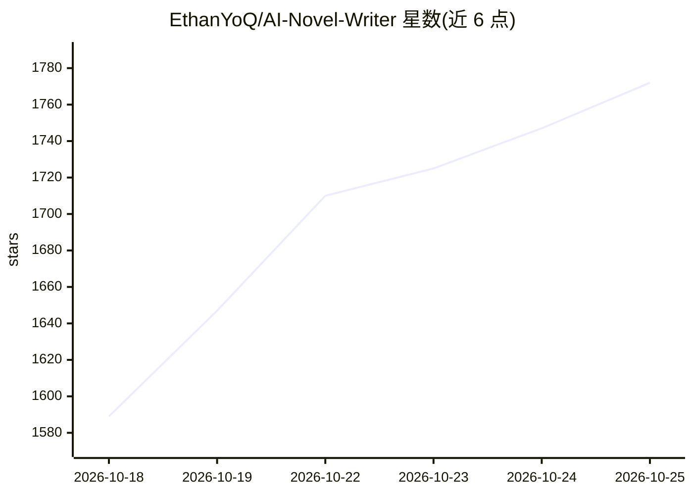

# EthanYoQ/AI-Novel-Writer

⭐ 1,817 · TypeScript · GPL-3.0 · 推送 2026-10-25 · [GitHub](https://github.com/EthanYoQ/AI-Novel-Writer) · [官网](https://github.com/EthanYoQ/AI-Novel-Writer/releases/latest) · 个人维护 · 中文 README

**面向长篇小说与网文连载的 AI 写作桌面软件**

Electron 桌面应用「书童 Pagekin」（原 AI 小说作家），按设定、架构、章节蓝图、正文写稿、审稿、修稿、定稿的流程辅助长篇写作；支持拆解参考小说仿写、导入原稿续写、段落续写与改写，可从 GitHub 导入提示词型写作 Skill（仅 SKILL.md，不执行脚本）。本地优先：作品存本地文件夹与 SQLite，软件不带模型，用户自行填 API Key 或经 Ollama 跑本地模型，支持 OpenAI 兼容与 Gemini 原生两种协议及多家服务商预设。提供 Windows 与 macOS 安装包，也可从源码构建。

## 筛选速览

| 维度 | 判定 | 备注 |
|---|---|---|
| AI 角色 | `ai-native` | 本体是模型或模型工具 |
| 许可风险 | `viral` | GPL-3.0 |
| 部署形态 | `desktop` | 安装包/桌面程序 |
| 模型依赖 | local-ok | 支持本地模型 |
| 硬件要求 | — | 无带数字的原话,不猜 |
| 安装摩擦 | `low` | 无编译、无系统依赖或容器化 |
| 成熟度 | — | 结构信号不足 |

## 能力要点

- 设定→架构→蓝图→正文→审稿→定稿的长篇写作流程管理
- 拆解仿写/续写/改写与批量创作（一次最多 10 章）
- 提示词型写作 Skill 导入（仅自包含 SKILL.md，不安装执行脚本）
- 本地优先存储（作品文件夹+本地 SQLite），模型由用户自行配置

## 适用场景

- 长篇小说或网文连载从设定到定稿的全程辅助写作
- 导入自己已写的原稿让 AI 接着前文续写
- 拆解参考小说的结构与文风用于仿写
- 在本地用 Ollama 模型写作，作品数据不出本机

## 场景标签

`AI 写作` · 领域:内容生成

## 证据(README 行号)

> L9:  开源免费的 AI 小说写作桌面软件，为长篇小说和网文连载设计。
> L105: 书童不提供模型，也不代管额度。你在设置里填上自己的服务地址、模型名和 API Key。软件支持两种调用协议：
> L107: - **OpenAI 兼容协议**：Chat Completions 接口兼容的服务都可以用。

## 星数曲线

2026-10-18 1,589 → 2026-10-25 1,772（+183）

---
*卡片 v1 · prompt 1.4 · 生成 2026-10-21 · 置信度 mid · 依据 README sha `2dd4b8d5aa9f` · [字段定义](../../DATASET.md)*
