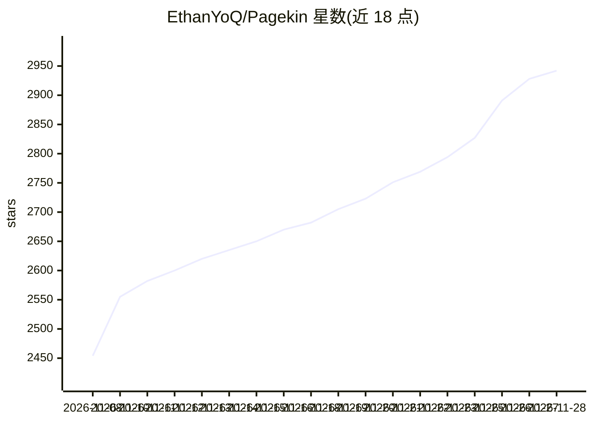

# EthanYoQ/Pagekin

⭐ 2,942 · TypeScript · GPL-3.0 · 推送 2026-11-27 · [GitHub](https://github.com/EthanYoQ/Pagekin) · [官网](https://www.orz.md/ai-novel-writer/) · 个人维护 · 中文 README

**给网文与长篇小说作者：本地优先的 AI 章节化写作软件**

开源桌面应用（Electron，Windows/macOS），按设定、架构、章节蓝图到正文写作/审稿/修稿/定稿的流程组织长篇创作。核心机制包括人物状态与关系按章时间线取值、伏笔线索到期提醒、蓝图 AI 一致性检查、批注统一修改、定稿后处理与版本/回收站管理。不带模型，用户自配 API Key 或本机推理服务；作品存本机 SQLite 与文件夹，支持 WebDAV 备份与 SKILL.md 写作规则导入。写作语言目前仅中文与英文。

## 筛选速览

| 维度 | 判定 | 备注 |
|---|---|---|
| AI 角色 | `ai-native` | 本体是模型或模型工具 |
| 许可风险 | `viral` | GPL-3.0 |
| 部署形态 | `desktop` | 安装包/桌面程序 |
| 模型依赖 | local-ok | 支持本地模型 |
| 硬件要求 | — | 无带数字的原话,不猜 |
| 安装摩擦 | `low` | 无编译、无系统依赖或容器化 |
| 成熟度 | — | 结构信号不足 |

## 能力要点

- 人物状态按章时间线取值，补写前面章节不会提前知晓后文
- 伏笔线索按到期章节写入提示词，审稿时核对回收
- 蓝图 AI 检查对照时间线找出关系颠倒或已死角色出场
- 支持 OpenAI/Gemini/Anthropic 三种协议与 Ollama 本地模型

## 适用场景

- 连载网文时跟踪人物状态和伏笔避免前后矛盾
- 导入已写原稿让 AI 接着续写后面的章节
- 全用本机模型离线写小说，作品不出电脑
- 拆解参考小说的结构与文风供仿写参考

## 场景标签

`AI 写作` · 领域:内容生成

## 证据(README 行号)

> L9:  书童（Pagekin）是一款免费开源的 AI 小说写作软件，适合在 Windows 和 macOS 上进行长篇小说和网文写作。
> L11:  本地优先：作品存在你自己的电脑上。软件不带模型：接你自己的 API Key（DeepSeek、OpenAI、Gemini、智谱等），或用 Ollama 跑本地模型。
> L42: 书童按写一本小说的顺序工作：你是作者，它是书童。每一步的结果都存进作品，下一步接着用。AI 负责起草，每一步由你确认。

## 星数曲线

2026-11-08 2,454 → 2026-11-28 2,942（+488）

---
*卡片 v1 · prompt 1.4 · 生成 2026-11-26 · 置信度 high · 依据 README sha `03d93793f20f` · [字段定义](../../DATASET.md)*
