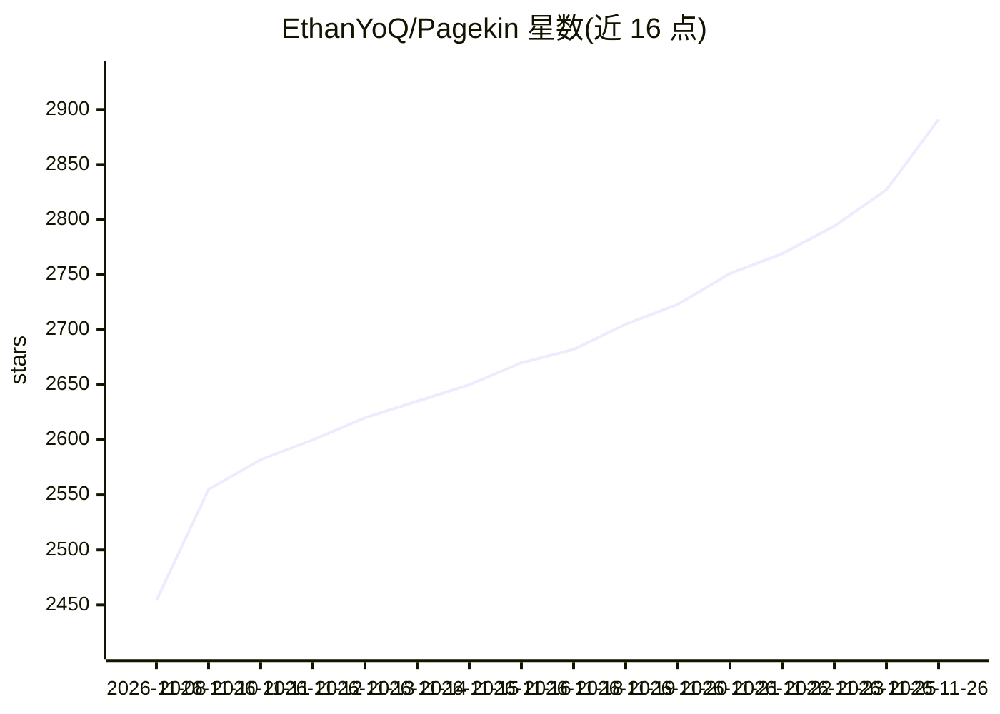

# EthanYoQ/Pagekin

⭐ 2,891 · TypeScript · GPL-3.0 · 推送 2026-11-25 · [GitHub](https://github.com/EthanYoQ/Pagekin) · [官网](https://www.orz.md/ai-novel-writer/) · 个人维护 · 中文 README

**给网文作者的本地优先 AI 写小说桌面软件**

书童 Pagekin 是一款 GPL-3.0 开源的 Electron 桌面应用，按设定、架构、角色、章节蓝图到正文写作、审稿、修稿、定稿的流程组织长篇小说创作。软件不附带模型，用户自行配置 OpenAI 兼容、Gemini 或 Anthropic 协议的服务地址与 API Key，也可接 Ollama 跑本机模型；上下文按章组装、人物状态按章取值、伏笔按到期章节提醒，修稿以差异形式逐段确认。作品存于本地 SQLite 与作品文件夹。Windows 与 macOS 提供安装包，也可从源码构建。

## 筛选速览

| 维度 | 判定 | 备注 |
|---|---|---|
| AI 角色 | `ai-native` | 本体是模型或模型工具 |
| 许可风险 | `viral` | GPL-3.0 |
| 部署形态 | `desktop` | 安装包/桌面程序 |
| 模型依赖 | local-ok | 支持本地模型 |
| 硬件要求 | — | 无带数字的原话,不猜 |
| 安装摩擦 | `low` | 无编译、无系统依赖或容器化 |
| 成熟度 | — | 结构信号不足 |

## 能力要点

- 按设定→蓝图→正文→审稿→定稿流程分步写作，每步结果存入作品
- 小说拆解与仿写、原稿导入续写、批注统一修改等改稿机制
- 支持导入提示词型写作 Skill（如去 AI 味），不执行脚本代码
- 支持三种模型调用协议及内置服务商预设，模型需自行配置

## 适用场景

- 一章一章地用 AI 写长篇小说或网文
- 导入已写好的原稿，让 AI 接着续写后面的章节
- 拆解参考小说的结构与文风，生成仿写约束辅助创作
- 用本机 Ollama 模型离线写作，作品数据不出本机

## 场景标签

`AI 写作` · 领域:内容生成

## 证据(README 行号)

> L9:  书童（Pagekin）是一款免费开源的 AI 写小说桌面软件，适用于 Windows 和 macOS，给想用 AI 写长篇小说的作者用。
> L11:  本地优先：作品存在你自己的电脑上。软件不带模型：接你自己的 API Key（DeepSeek、OpenAI、Gemini、智谱等），或用 Ollama 跑本地模型。

## 星数曲线

2026-11-08 2,454 → 2026-11-26 2,891（+437）

---
*卡片 v1 · prompt 1.4 · 生成 2026-11-24 · 置信度 high · 依据 README sha `5251d9e7faf4` · [字段定义](../../DATASET.md)*
