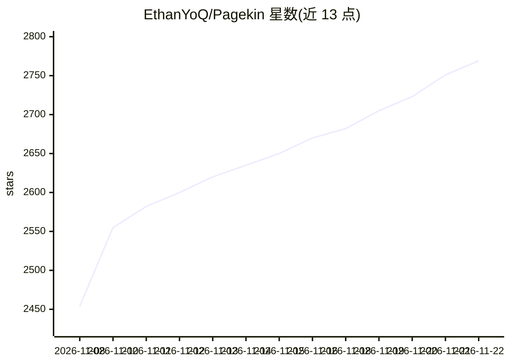

# EthanYoQ/Pagekin

⭐ 2,769 · TypeScript · GPL-3.0 · 推送 2026-11-21 · [GitHub](https://github.com/EthanYoQ/Pagekin) · [官网](https://www.orz.md/ai-novel-writer/) · 个人维护 · 中文 README

**面向长篇小说作者的本地优先 AI 写作桌面软件**

书童 Pagekin 是免费开源的 AI 小说写作软件（GPL-3.0，Electron 桌面应用，Windows/macOS 安装包）。按设定→架构→章节蓝图→写稿→审稿→修稿→定稿的流程组织长篇写作，支持拆解参考小说仿写、导入原稿续写、段落续写与改写、批量创作（一次最多 10 章）。软件本身不带模型：用户自行配置 API Key 或用 Ollama 跑本地模型，支持 OpenAI 兼容协议与 Gemini 原生协议，内置 DeepSeek、SiliconFlow、智谱、OpenAI、xAI、Gemini、Ollama、NovelAI 预设。作品数据存本地文件夹与 SQLite，可导入提示词型写作 Skill（如去 AI 味），Skill 不能执行代码。安装包未签名，需用户确认官方 Release 来源。

## 筛选速览

| 维度 | 判定 | 备注 |
|---|---|---|
| AI 角色 | `ai-native` | 本体是模型或模型工具 |
| 许可风险 | `viral` | GPL-3.0 |
| 部署形态 | `desktop` | 安装包/桌面程序 |
| 模型依赖 | local-ok | 支持本地模型 |
| 硬件要求 | — | 无带数字的原话,不猜 |
| 安装摩擦 | `low` | 无编译、无系统依赖或容器化 |
| 成熟度 | — | 结构信号不足 |

## 能力要点

- 设定/架构/蓝图/正文/审稿/定稿的分步写作流程，每步结果存进作品
- 拆解参考小说生成仿写约束，或导入原稿按章节号续写
- 支持 OpenAI 兼容与 Gemini 原生协议，内置 8 家服务商预设，可接 Ollama 本地模型
- 导入 SKILL.md 提示词型写作 Skill 并绑定到规划/写稿/审稿/修稿阶段，不执行代码

## 适用场景

- 从零开始写一部长篇小说，用 AI 起草、自己审阅定稿
- 把已写一半的原稿导入，让 AI 接着前文人物情节续写
- 拆解喜欢的参考小说，提取结构与文风做仿写练习
- 不想把作品发云端时，用 Ollama 本地模型完成全流程写作

## 场景标签

`AI 写作` · 领域:内容生成

## 证据(README 行号)

> L10:  从设定、架构、章节蓝图到正文、审稿、修稿、定稿，一章一章把书写完；也能拆解参考小说来仿写、导入原稿接着续写，或按你的要求改写。
> L11:  本地优先：作品存在你自己的电脑上。软件不带模型：接你自己的 API Key，或用 Ollama 跑本地模型。
> L99: 书童不提供模型，也不代管额度。你在设置里填上自己的服务地址、模型名和 API Key。软件支持两种调用协议：

## 星数曲线

2026-11-08 2,454 → 2026-11-22 2,769（+315）

---
*卡片 v1 · prompt 1.4 · 生成 2026-11-17 · 置信度 mid · 依据 README sha `97551abe5056` · [字段定义](../../DATASET.md)*
