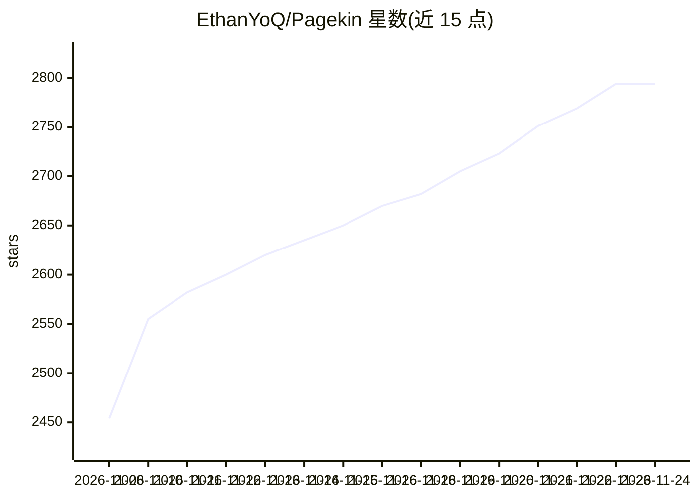

# EthanYoQ/Pagekin

⭐ 2,794 · TypeScript · GPL-3.0 · 推送 2026-11-22 · [GitHub](https://github.com/EthanYoQ/Pagekin) · [官网](https://www.orz.md/ai-novel-writer/) · 个人维护 · 中文 README

**面向网文作者的 AI 长篇小说桌面写作软件**

书童（Pagekin，原名 AI Novel Writer）是一款 Electron 桌面应用，按写一本长篇小说的流程组织功能：设定、架构、角色时间线、章节蓝图、正文写稿、审稿、修稿、定稿，另有伏笔线索到期提醒、知识库检索、批量创作、版本历史、回收站与导出。本地优先，作品存于本机 SQLite 数据库与作品文件夹；软件不带模型，用户自行配置 API Key 或本机推理服务，支持三种调用协议（OpenAI 兼容、Gemini 原生、Anthropic）。以 GPL-3.0 协议开源，提供 Windows x64 与 macOS 安装包，也可从源码构建。

## 筛选速览

| 维度 | 判定 | 备注 |
|---|---|---|
| AI 角色 | `ai-native` | 本体是模型或模型工具 |
| 许可风险 | `viral` | GPL-3.0 |
| 部署形态 | `desktop` | 安装包/桌面程序 |
| 模型依赖 | local-ok | 支持本地模型 |
| 硬件要求 | — | 无带数字的原话,不猜 |
| 安装摩擦 | `low` | 无编译、无系统依赖或容器化 |
| 成熟度 | — | 结构信号不足 |

## 能力要点

- 从设定、蓝图到正文、审稿、定稿的一章一章写作流程
- 人物状态与关系按章取值的时间线机制，写第 N 章用第 N 章的人物状态
- 支持导入写作 Skill（仅提示词型 SKILL.md），绑定到规划/写稿/审稿/修稿阶段
- 三种调用协议接入外部模型，支持 Ollama 本地模型与分工模型配置

## 适用场景

- 用 AI 一章一章写长篇小说或网文，作品数据存本机
- 导入已有原稿或参考小说，拆解仿写或接着续写
- 用本机模型离线写作，避免正文上传云端

## 场景标签

`AI 写作` · 领域:内容生成

## 证据(README 行号)

> L9:  书童（Pagekin）是一款免费开源的 AI 写小说桌面软件，适用于 Windows 和 macOS，给想用 AI 写长篇小说的作者用。
> L10:  从设定、架构、角色、章节蓝图到正文的写作、审稿、修稿、定稿，一章一章把书写完。也能拆解参考小说来仿写、导入自己的原稿接着续写，或按你的意见改写。

## 星数曲线

2026-11-08 2,454 → 2026-11-24 2,794（+340）

---
*卡片 v1 · prompt 1.4 · 生成 2026-11-23 · 置信度 mid · 依据 README sha `40b627e2283a` · [字段定义](../../DATASET.md)*
