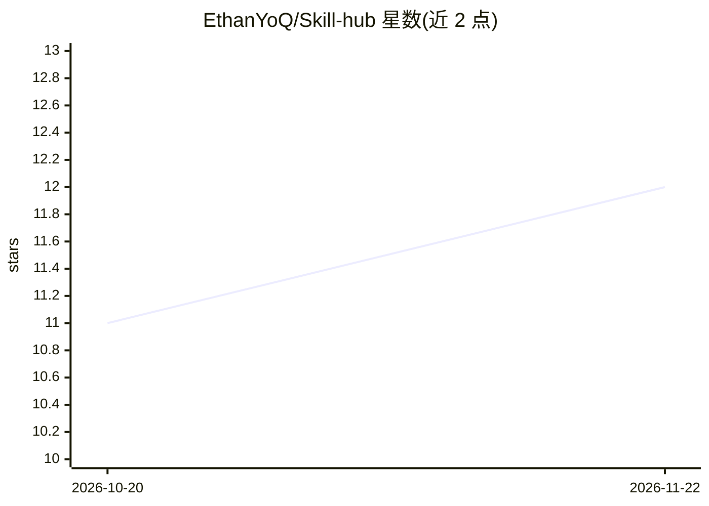

# EthanYoQ/Skill-hub

⭐ 12 · JavaScript · MIT · 推送 2026-11-07 · [GitHub](https://github.com/EthanYoQ/Skill-hub) · 个人维护 · 中文 README

**面向 Codex/Claude Code 等的中文 Agent 技能库**

以中文组织的开源 Agent 技能仓库，收集 58 个可复用 SKILL.md 技能，按 Agent 工程、编程语言、框架、数据检索、媒体内容、写作营销、行业业务等能力域分组。提供名称/能力域索引、机器可读 skills-lock.json、上游来源索引与同步脚本（推送/拉回/重建索引/审计上游），含 Directory Junction 共享技能目录的 PowerShell 脚本与隐私脱敏规范。通过 git clone 获取本地使用；上游自动更新仅作用于 mirror 类技能，其余需人工合并。

## 筛选速览

| 维度 | 判定 | 备注 |
|---|---|---|
| AI 角色 | `ai-knowledge` | 知识聚合/清单类 |
| 许可风险 | `permissive` | MIT |
| 部署形态 | `None` |  |
| 模型依赖 | — | README 未给出锁定关系 |
| 硬件要求 | — | 无带数字的原话,不猜 |
| 安装摩擦 | `low` | 无编译、无系统依赖或容器化 |
| 成熟度 | — | 结构信号不足 |

## 能力要点

- 58 个技能按 7 个能力域组织，含 by-name/by-domain/机器可读三套索引
- _meta/skill-upstreams.json 来源索引记录上游验证状态与升级策略
- 提供 sync-push/sync-pull/build-indexes/refresh-upstream-skills 等 PowerShell 脚本
- GitHub Actions 每周自动比对 mirror 类上游并创建 PR，保留人工审查门

## 适用场景

- 为 Codex 或 Claude Code 查找可复用的结构化 Agent 技能
- 把个人项目工作流沉淀成 SKILL.md 并纳入分组目录管理
- 多个 Agent 工具通过 Directory Junction 共享同一份本地技能目录
- 跟踪已验证开源上游并对技能做有证据的升级维护

## 场景标签

`提示工程` `精选清单` · 领域:Agent 开发

## 证据(README 行号)

> L11: Skill-hub 是一个面向 Codex、Claude Code、Antigravity 等 AI 编程工具的中文 Agent 技能库，收集可复用的 `SKILL.md` 自动化实践、AI 编程工作流和提示词模板。仓库当前包含 
> L21: Skill-hub 不是单一提示词合集，而是面向 Agent 使用的技能仓库。每个技能通常包含触发条件、执行步骤、约束、参考资料或脚本，让 AI 编程助手能在相似任务中复用稳定流程。
> L29: |检索入口|通过 `_meta/` 下的索引按名称、能力域或技术栈查找技能。|

## 星数曲线

2026-10-20 11 → 2026-11-22 12（+1）

---
*卡片 v1 · prompt 1.4 · 生成 2026-11-19 · 置信度 high · 依据 README sha `f77f57baeedf` · [字段定义](../../DATASET.md)*
