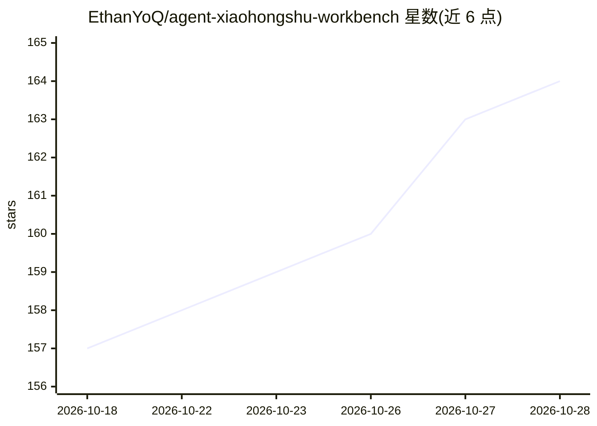

# EthanYoQ/agent-xiaohongshu-workbench

⭐ 164 · JavaScript · MIT · 推送 2026-09-07 · [GitHub](https://github.com/EthanYoQ/agent-xiaohongshu-workbench) · 个人维护 · 中文 README

**面向多账号创作者的小红书图文内容本地 Agent 工作台**

本地运行的桌面工作台（Electron 前后端），把账号定位、热点研究、选题、文稿生成、品牌配图、预览与人工确认组织为可暂停、可编辑的流程。每个内容账号独立保存定位、品牌角色与热点缓存，共用一个浏览器研究会话。推理与浏览器操作由本地 Codex Agent 完成，不接入第三方模型 API、不托管账号数据；发布账号默认未绑定，需用户手动确认风险。运行需 Node.js、Codex CLI、Chrome 与 OpenCLI Browser Bridge。提供 Windows 与 Apple Silicon 安装包（macOS 包未签名未公证）。

## 筛选速览

| 维度 | 判定 | 备注 |
|---|---|---|
| AI 角色 | `ai-native` | 本体是模型或模型工具 |
| 许可风险 | `permissive` | MIT |
| 部署形态 | `desktop` | 安装包/桌面程序 |
| 模型依赖 | — | README 未给出锁定关系 |
| 硬件要求 | — | 无带数字的原话,不猜 |
| 安装摩擦 | `low` | 无编译、无系统依赖或容器化 |
| 成熟度 | — | 结构信号不足 |

## 能力要点

- 多内容账号隔离：独立定位、品牌角色、热点缓存、稿件与故事线
- 内置 Lingzao 热点拆解与中文去 AI 味 Skill，生成可编辑终稿
- 品牌角色与配图由 Codex Agent 内置生图能力生成，逐张预览
- 发布守卫：账号默认未绑定，任何发布需预览与界面再次确认

## 适用场景

- 持续运营多个小红书图文账号的创作者管理定位与选题
- 把平台热点拆解为符合账号调性的原创图文
- 在本地完成文稿、品牌配图与发布前人工确认

## 场景标签

`AI 写作` `图像生成` `浏览器自动化` · 领域:效率与自动化

## 证据(README 行号)

> L7: Agent 小红书工作台面向需要持续运营多个图文内容账号的创作者。每个内容账号拥有独立的定位、品牌角色、视觉语言、热点缓存、稿件和故事线；它们共用一个仅用于浏览器研究的执行会话。它不接入第三方模型 API，也不托管账号数据；Code
> L46: 5. 生成初稿，再通过内置中文去 AI 味 Skill 形成可编辑终稿。
> L68: |品牌角色|Codex Agent 的内置生图能力|本地上传母版；固定身份、发型、穿着、比例与渲染方式，生成并逐张预览 6 个系列形象|

## 星数曲线

2026-10-18 157 → 2026-10-28 164（+7）

---
*卡片 v1 · prompt 1.4 · 生成 2026-10-22 · 置信度 high · 依据 README sha `20f636f6395d` · [字段定义](../../DATASET.md)*
