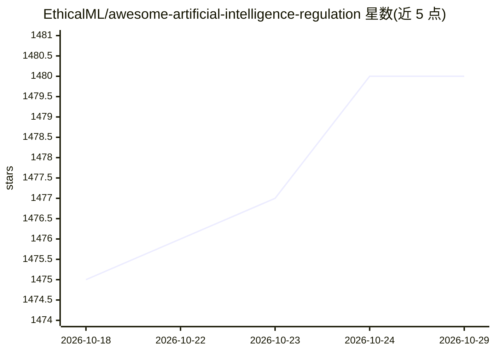

# EthicalML/awesome-artificial-intelligence-regulation

⭐ 1,480 · MIT · 推送 2026-10-28 · [GitHub](https://github.com/EthicalML/awesome-artificial-intelligence-regulation) · 组织维护

**AI 伦理、法规与准则资源的策展清单**

由 EthicalML（Institute for Ethical AI 关联）维护的 Awesome 类清单仓库，汇集全球 AI 相关的指南、原则、伦理准则、行业标准和法规资源。内容按国家/经济体分区（奥地利、巴西、加拿大、中国、欧盟、印度、英国、美国等），另含高层框架、行业标准、实用工具、在线课程、检查清单和研究通讯等栏目。条目以链接加简介形式收录，供从业者和研究者导航查阅，不提供可安装的软件。

## 筛选速览

| 维度 | 判定 | 备注 |
|---|---|---|
| AI 角色 | `ai-knowledge` | 知识聚合/清单类 |
| 许可风险 | `permissive` | MIT |
| 部署形态 | `None` |  |
| 模型依赖 | — | README 未给出锁定关系 |
| 硬件要求 | — | 无带数字的原话,不猜 |
| 安装摩擦 | `low` | 无编译、无系统依赖或容器化 |
| 成熟度 | — | 结构信号不足 |

## 能力要点

- 按国家/经济体组织各国 AI 法规与政策条目
- 覆盖高层伦理框架、行业标准、检查清单与实用工具
- 每条目附一句话说明与原文链接

## 适用场景

- 查找各国 AI 监管法规与国家战略原文
- 了解 AI 伦理原则、框架与行业标准的资源全景
- 合规与治理工作中查找检查清单与实用工具

## 场景标签

`精选清单` · 领域:学习与行业

## 证据(README 行号)

> L18: This repository aims to simplify this by mapping the ecosystem of guidelines, principles, codes of ethics, standard
> L22: ### National Regulation by Economic Area

## 星数曲线

2026-10-18 1,475 → 2026-10-29 1,480（+5）

---
*卡片 v1 · prompt 1.4 · 生成 2026-10-21 · 置信度 high · 依据 README sha `812961e1f04d` · [字段定义](../../DATASET.md)*
