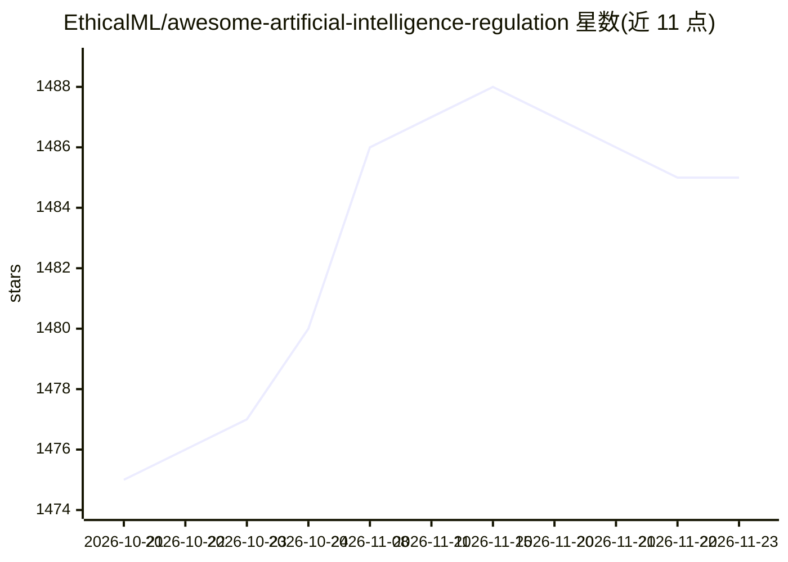

# EthicalML/awesome-artificial-intelligence-regulation

⭐ 1,485 · MIT · 推送 2026-11-16 · [GitHub](https://github.com/EthicalML/awesome-artificial-intelligence-regulation) · 组织维护

**面向从业者的 AI 法规、原则与伦理框架导航清单**

按经济体组织各国 AI 法规与政策的链接清单（奥地利、巴西、加拿大、中国、欧盟、印度、新加坡、阿联酋等），并设高层框架与原则、行业标准倡议、交互式实用工具、在线课程、流程清单、研究通讯等其他板块。每条以一句话摘要说明来源文件的发布方与覆盖内容。仓库定位为绘制 AI 指南、原则、伦理规范、标准与法规的生态地图，帮助从业者导航大量已发布的治理类资源；自身不提供安装与运行方式。

## 筛选速览

| 维度 | 判定 | 备注 |
|---|---|---|
| AI 角色 | `ai-knowledge` | 知识聚合/清单类 |
| 许可风险 | `permissive` | MIT |
| 部署形态 | `None` |  |
| 模型依赖 | — | README 未给出锁定关系 |
| 硬件要求 | — | 无带数字的原话,不猜 |
| 安装摩擦 | `low` | 无编译、无系统依赖或容器化 |
| 成熟度 | — | 结构信号不足 |

## 能力要点

- 按 15+ 经济体分区的各国 AI 法规与政策链接
- 覆盖框架原则、行业标准、实用工具、在线课程等板块
- 每条目附一句来源与内容摘要

## 适用场景

- 查询某国/地区已发布或拟议中的 AI 法规
- 合规团队查找 EU AI Act、ISO 42001、NIST AI RMF 对齐类资源
- 了解 AI 伦理框架与检查清单的分布

## 场景标签

`精选清单` · 领域:学习与行业

## 证据(README 行号)

> L16: There has been a large amount of content published which attempts to address these issues through "Principles", "Et
> L18: This repository aims to simplify this by mapping the ecosystem of guidelines, principles, codes of ethics, standard
> L42: # Regulation and Policy

## 星数曲线

2026-10-21 1,475 → 2026-11-23 1,485（+10）

---
*卡片 v1 · prompt 1.4 · 生成 2026-11-23 · 置信度 high · 依据 README sha `fd90babc87a5` · [字段定义](../../DATASET.md)*
