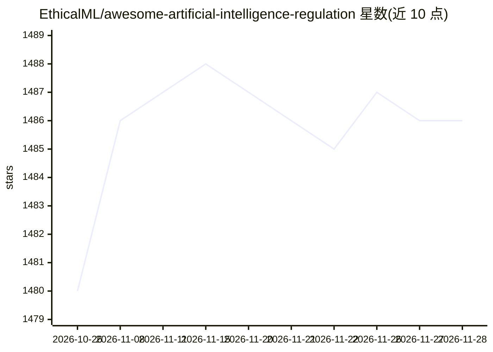

# EthicalML/awesome-artificial-intelligence-regulation

⭐ 1,486 · MIT · 推送 2026-11-25 · [GitHub](https://github.com/EthicalML/awesome-artificial-intelligence-regulation) · 组织维护

**面向从业者收录全球 AI 法规、伦理原则与标准清单**

一个以清单形式组织的资源索引，按经济体（奥地利、巴西、加拿大、中国、欧盟、印度等 15+ 国家/地区）收录 AI 监管法规与政策，并设有高层框架与原则、行业标准倡议、交互式实用工具、在线课程、流程与检查清单、研究通讯等分节。维护方为 Institute for Ethical AI，面向需要在伦理与合规场景中查找权威资料的从业者，README 本身不含安装或运行内容。

## 筛选速览

| 维度 | 判定 | 备注 |
|---|---|---|
| AI 角色 | `ai-knowledge` | 知识聚合/清单类 |
| 许可风险 | `permissive` | MIT |
| 部署形态 | `None` |  |
| 模型依赖 | — | README 未给出锁定关系 |
| 硬件要求 | — | 无带数字的原话,不猜 |
| 安装摩擦 | `low` | 无编译、无系统依赖或容器化 |
| 成熟度 | — | 结构信号不足 |

## 能力要点

- 按 15+ 国家/地区组织的 AI 法规与政策索引
- 覆盖高层框架、行业标准、实用工具、在线课程等分节
- 收录中国生成式 AI 管理办法、欧盟 AI Act、加拿大 AIDA 等具体法规条目

## 适用场景

- 查找某国家/地区现行的 AI 监管法规原文与解读
- 为合规工作检索框架、检查清单与评估工具
- 了解各国 AI 伦理原则与行业标准的发布动态

## 场景标签

`教程课程` `精选清单` · 领域:学习与行业

## 证据(README 行号)

> L18: This repository aims to simplify this by mapping the ecosystem of guidelines, principles, codes of ethics, standard
> L35: |🔍 High Level Frameworks & Principles|📜 Industry standards initiatives|🔨 Interactive & Practical Tools|

## 星数曲线

2026-10-26 1,480 → 2026-11-28 1,486（+6）

---
*卡片 v1 · prompt 1.4 · 生成 2026-11-26 · 置信度 high · 依据 README sha `73a2a62be245` · [字段定义](../../DATASET.md)*
