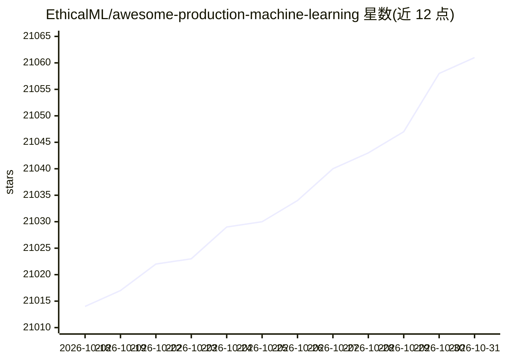

# EthicalML/awesome-production-machine-learning

⭐ 21,061 · MIT · 推送 2026-10-28 · [GitHub](https://github.com/EthicalML/awesome-production-machine-learning) · [官网](https://ethicalml.github.io/awesome-production-machine-learning) · 组织维护

**生产级机器学习开源库策展清单：部署/监控/版本/扩展**

由 EthicalML 维护的 MLOps 工具策展清单，收录用于部署、监控、版本管理、扩展与安全防护生产机器学习的开源库，按 AutoML、数据管道、部署与服务、评估与监控、可解释性、特征存储、隐私安全等 25+ 个类别组织条目。另提供一个搜索工具包帮助在工具链中导航，并配有 10 分钟视频概览与月度 release 更新摘要。条目覆盖从训练优化、分布式计算到行业级 CV/NLP/推荐系统的各类库。

## 筛选速览

| 维度 | 判定 | 备注 |
|---|---|---|
| AI 角色 | `ai-knowledge` | 知识聚合/清单类 |
| 许可风险 | `permissive` | MIT |
| 部署形态 | `library` | 以包/库形式分发 |
| 模型依赖 | — | README 未给出锁定关系 |
| 硬件要求 | — | 无带数字的原话,不猜 |
| 安装摩擦 | `medium` | 含编译或系统依赖之一 |
| 成熟度 | — | 结构信号不足 |

## 动量与使用信号

- 维护:`active` — 距上次 push 10.1 天,年发版 11,204 位贡献者
- 涨星:近 1 天 **+3**(自 20261016 起算)
- 下载:GitHub Release 附件 累计 888(41 个 release)
- 平台:— · 协议:OPENAI-API / OLLAMA

## 能力要点

- 按 25+ 类别组织生产 ML 工具链条目（部署、监控、特征存储、隐私等）
- 提供搜索工具包用于快速导航工具链
- 通过 GitHub release 每月汇总新增库
- 附 10 分钟 MLOps 视频概览（2024 版）

## 适用场景

- 为生产 ML 项目选型部署、监控与版本管理工具
- 按类别浏览 MLOps 生态中的开源库
- 跟踪每月新出现的产品级 ML 库

## 场景标签

`精选清单` · 领域:学习与行业

## 证据(README 行号)

> L6: This repository contains a curated list of awesome open source libraries that will help you deploy, monitor, version
> L10: Additionally, we provide a search toolkit that helps you quickly navigate through the toolchain.

## 星数曲线

2026-10-18 21,014 → 2026-10-31 21,061（+47）

---
*卡片 v1 · prompt 1.4 · 生成 2026-10-20 · 置信度 high · 依据 README sha `ea92ea14270b` · [字段定义](../../DATASET.md)*
