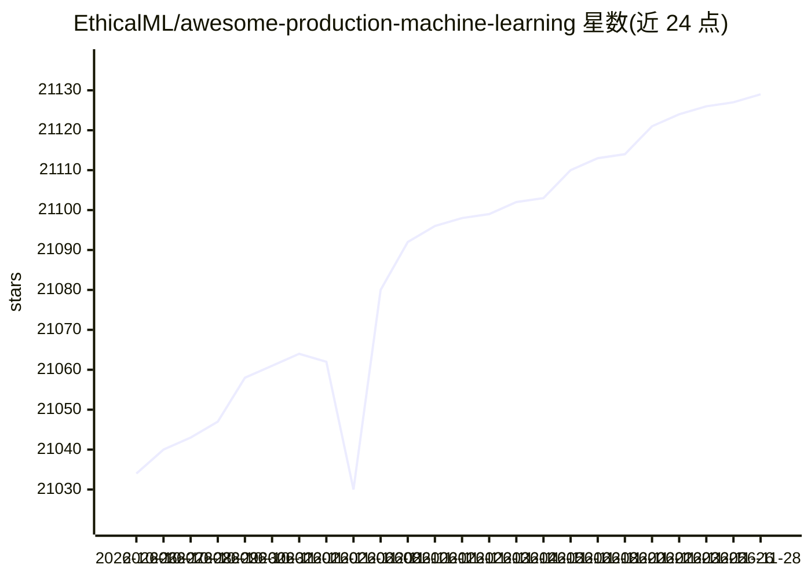

# EthicalML/awesome-production-machine-learning

⭐ 21,129 · MIT · 推送 2026-11-24 · [GitHub](https://github.com/EthicalML/awesome-production-machine-learning) · [官网](https://ethicalml.github.io/awesome-production-machine-learning) · 组织维护

**生产级机器学习开源库策展清单，供部署运维选型**

由 EthicalML 维护的 awesome 类清单，收录用于部署、监控、版本管理、扩展与保障生产机器学习的开源库。内容按 20 余个类别组织，涵盖 AutoML、计算与通信优化、部署与服务、评估监控、可解释性与公平性、特征存储、模型与实验管理等；提供页内快速导航与搜索工具包，通过 GitHub releases 每月汇总新增条目，另配套 10 分钟概述视频与机器学习工程师 newsletter，并维护姊妹 GenAI 清单。

## 筛选速览

| 维度 | 判定 | 备注 |
|---|---|---|
| AI 角色 | `ai-knowledge` | 知识聚合/清单类 |
| 许可风险 | `permissive` | MIT |
| 部署形态 | `library` | 以包/库形式分发 |
| 模型依赖 | — | README 未给出锁定关系 |
| 硬件要求 | — | 无带数字的原话,不猜 |
| 安装摩擦 | `medium` | 含编译或系统依赖之一 |
| 成熟度 | — | 结构信号不足 |

## 动量与使用信号

- 维护:`active` — 距上次 push 10.1 天,年发版 11,204 位贡献者
- 涨星:近 1 天 **+3**(自 20261016 起算)
- 下载:GitHub Release 附件 累计 888(41 个 release)
- 平台:— · 协议:OPENAI-API / OLLAMA

## 能力要点

- 按 20+ 类别组织的生产 ML 开源库清单（AutoML、部署服务、监控、可解释性等）
- 提供搜索工具包帮助导航工具链
- 通过 GitHub releases 每月汇总新增库
- 配套 MLOps 概述视频与每周 newsletter

## 适用场景

- 为模型上线挑选部署、监控、版本管理工具
- 按类别查找生产级 ML 开源库
- 跟踪每月新增的生产机器学习库

## 场景标签

`精选清单` `MLOps` · 领域:学习与行业

## 证据(README 行号)

> L6: This repository contains a curated list of awesome open source libraries that will help you deploy, monitor, version
> L10: Additionally, we provide a search toolkit that helps you quickly navigate through the toolchain.
> L58: ## AutoML

## 星数曲线

2026-10-26 21,034 → 2026-11-28 21,129（+95）

---
*卡片 v1 · prompt 1.4 · 生成 2026-11-26 · 置信度 mid · 依据 README sha `47e731e853aa` · [字段定义](../../DATASET.md)*
