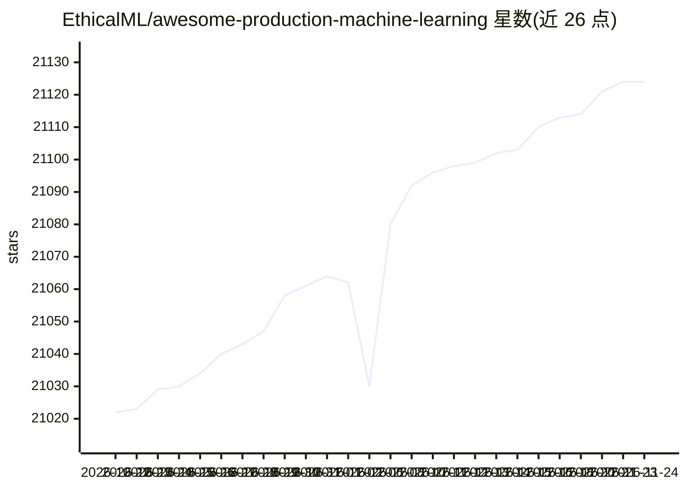

# EthicalML/awesome-production-machine-learning

⭐ 21,126 · MIT · 推送 2026-11-12 · [GitHub](https://github.com/EthicalML/awesome-production-machine-learning) · [官网](https://ethicalml.github.io/awesome-production-machine-learning) · 组织维护

**生产级机器学习开源工具库的策展清单**

面向机器学习工程师的开源库聚合清单，收录用于部署、监控、版本管理、扩展与安全化生产 ML 的工具。按约 27 个类别组织，包括 AutoML、计算与通信优化、部署与推理、评估与监控、可解释性与公平性、特征库、模型/数据/实验管理等。通过 GitHub releases 每月汇总新增条目，附搜索工具包、10 分钟视频概览与每周 ML 工程师通讯，社区通过 CONTRIBUTING.md 规范提交 PR。

## 筛选速览

| 维度 | 判定 | 备注 |
|---|---|---|
| AI 角色 | `ai-knowledge` | 知识聚合/清单类 |
| 许可风险 | `permissive` | MIT |
| 部署形态 | `library` | 以包/库形式分发 |
| 模型依赖 | — | README 未给出锁定关系 |
| 硬件要求 | — | 无带数字的原话,不猜 |
| 安装摩擦 | `medium` | 含编译或系统依赖之一 |
| 成熟度 | — | 结构信号不足 |

## 动量与使用信号

- 维护:`active` — 距上次 push 10.1 天,年发版 11,204 位贡献者
- 涨星:近 1 天 **+3**(自 20261016 起算)
- 下载:GitHub Release 附件 累计 888(41 个 release)
- 平台:— · 协议:OPENAI-API / OLLAMA

## 能力要点

- 约 27 个 MLOps 类别的开源库策展清单
- 通过 GitHub releases 每月汇总新增条目
- 提供搜索工具包与 10 分钟视频概览
- 配套 Awesome Production GenAI List 与 70,000+ 订阅者通讯

## 适用场景

- 为模型部署、监控与版本管理寻找合适的开源工具
- 按类别浏览 MLOps 工具链的选型范围
- 跟踪每月新增的生产级 ML 库

## 场景标签

`精选清单` · 领域:学习与行业

## 证据(README 行号)

> L6: This repository contains a curated list of awesome open source libraries that will help you deploy, monitor, version
> L16: |🔧 AutoML|🧮 Computation & Communication Optimisation|🏷️ Data Annotation & Synthesis|

## 星数曲线

2026-10-22 21,022 → 2026-11-24 21,124（+102）

---
*卡片 v1 · prompt 1.4 · 生成 2026-11-22 · 置信度 mid · 依据 README sha `be9f8498bf74` · [字段定义](../../DATASET.md)*
