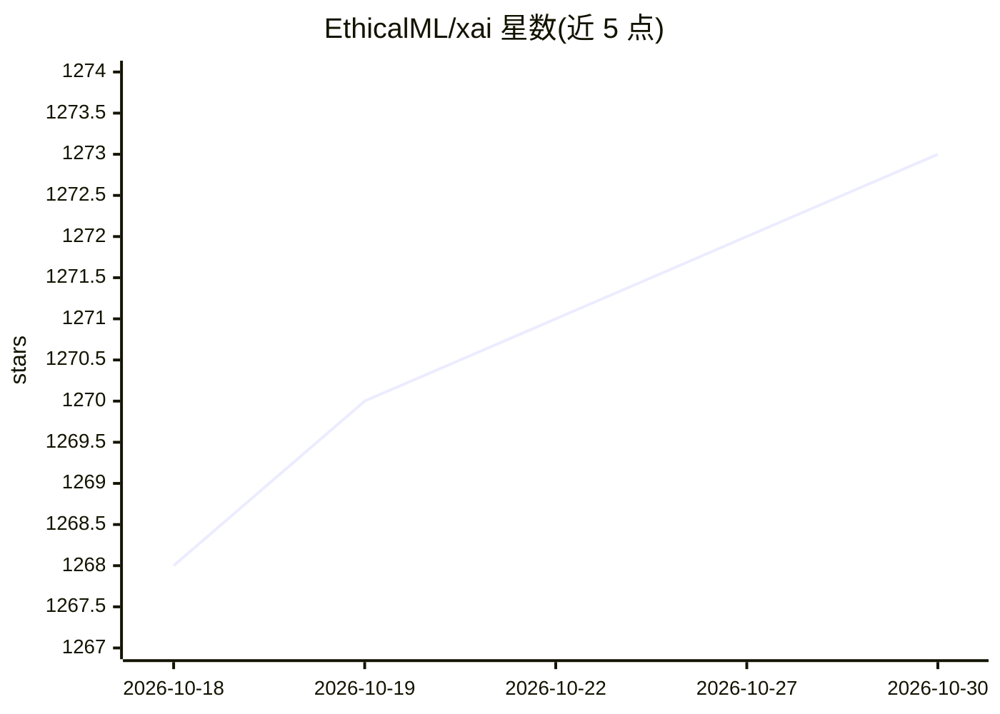

# EthicalML/xai

⭐ 1,273 · Python · MIT · 推送 2025-11-29 · [GitHub](https://github.com/EthicalML/xai) · [官网](https://ethical.institute/principles.html#commitment-3) · 组织维护

**机器学习可解释性工具库：数据分析、模型评估与偏差检测**

The Institute for Ethical AI & ML 维护的 Python 库，基于负责任机器学习 8 原则设计，围绕可解释机器学习三步骤组织功能：数据分析（类别不平衡可视化、上/下采样重平衡、相关性与树状图、均衡训练测试划分）、模型评估（排列特征重要性、按保护列分组的指标不平衡与 ROC 曲线、混淆矩阵）以及按概率分桶的统计指标与人审阈值收益分析。面向机器学习工程师与领域专家，通过 PyPI 安装，内置 census 数据集与示例 Notebook。

## 筛选速览

| 维度 | 判定 | 备注 |
|---|---|---|
| AI 角色 | `ai-ecosystem` | LLM/agent 周边工具 |
| 许可风险 | `permissive` | MIT |
| 部署形态 | `library` | 以包/库形式分发 |
| 模型依赖 | — | README 未给出锁定关系 |
| 硬件要求 | — | 无带数字的原话,不猜 |
| 安装摩擦 | `low` | 无编译、无系统依赖或容器化 |
| 成熟度 | — | 结构信号不足 |

## 能力要点

- 类别不平衡可视化与上/下采样重平衡（xai.balance）
- 按保护列（性别/族裔等）分组检测指标不平衡与 ROC 差异
- 排列特征重要性计算与混淆矩阵、ROC 曲线绘制
- 按概率分桶展示统计指标及人工审核阈值收益

## 适用场景

- 训练前发现数据集中的类别与分布不平衡
- 检查模型在不同人群分组上的指标差异以发现偏差
- 评估引入人工审核环节对分类结果的影响

## 场景标签

`模型评测` · 领域:评测与运维

## 证据(README 行号)

> L8: XAI is a Machine Learning library that is designed with AI explainability in its core. XAI contains various tools th
> L24: We see the challenge of explainability as more than just an algorithmic challenge, which requires a combination of 

## 星数曲线

2026-10-18 1,268 → 2026-10-30 1,273（+5）

---
*卡片 v1 · prompt 1.4 · 生成 2026-10-21 · 置信度 high · 依据 README sha `015a8af4c414` · [字段定义](../../DATASET.md)*
