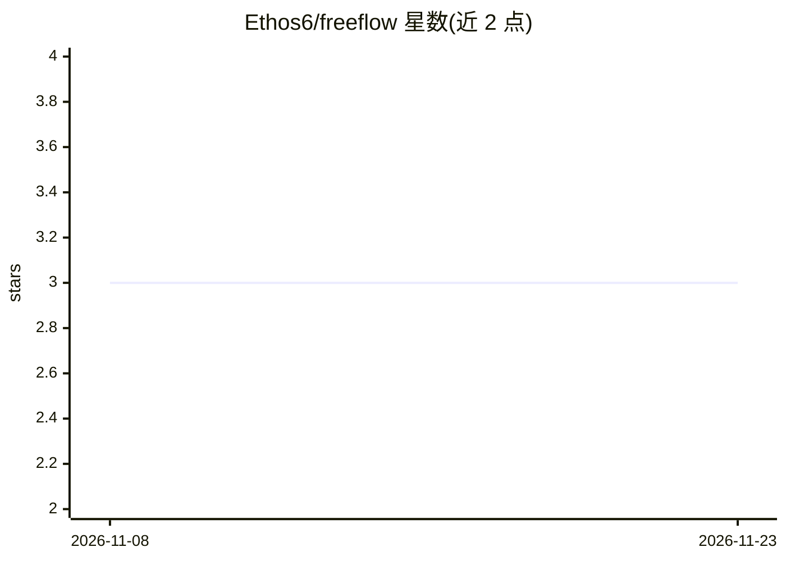

# Ethos6/freeflow

⭐ 3 · JavaScript · MIT · 推送 2026-11-15 · [GitHub](https://github.com/Ethos6/freeflow) · 个人维护

**本地 LLM 网关：为编码 agent 提供 58 家模型源的自动回退**

运行于本机的 API 网关，位于编码 agent 与模型服务商之间：将 Claude Code、OpenCode、Aider 等客户端的 Anthropic Messages / OpenAI Chat 请求转换为各家 provider 的格式，按用户配置的路由与回退链逐级尝试；触发限流、超时、坏 key 时切换到下一 provider，并对失败的 provider 做冷却退避。附带本地 dashboard 用于配置 key、路由与查看实时流量。Node 22+ 运行，无运行时依赖，仅监听 127.0.0.1。

## 筛选速览

| 维度 | 判定 | 备注 |
|---|---|---|
| AI 角色 | `ai-ecosystem` | LLM/agent 周边工具 |
| 许可风险 | `permissive` | MIT |
| 部署形态 | `library` | 以包/库形式分发 |
| 模型依赖 | local-ok | 支持本地模型 |
| 硬件要求 | — | 无带数字的原话,不猜 |
| 安装摩擦 | `low` | 无编译、无系统依赖或容器化 |
| 成熟度 | — | 结构信号不足 |

## 能力要点

- 58 家 provider、免费层优先的多级回退链与 provider 冷却机制
- Anthropic Messages 与 OpenAI Chat Completions 双向转换（工具调用/思考块/图像）
- 本地 dashboard：key 管理、路由编辑、实时活动流
- 零运行时依赖，约 2,300 行 JavaScript

## 适用场景

- 免费额度用完时让编码 agent 自动切换到下一家免费模型
- 在 Claude Code 等工具中混用本地模型与云端模型
- 集中管理多家 provider 的 API key 并观察请求走向

## 场景标签

`模型网关` · 领域:Agent 开发

## 证据(README 行号)

> L5: One local gateway that lets Claude Code, OpenCode, Aider and any other coding agent use 58 model providers, free tie
> L24: freeflow sits between your agent and the providers. You pick a model for each kind of request and a chain of fallba

## 星数曲线

2026-11-08 3 → 2026-11-23 3（+0）

---
*卡片 v1 · prompt 1.4 · 生成 2026-11-22 · 置信度 high · 依据 README sha `e09ec6a2b350` · [字段定义](../../DATASET.md)*
