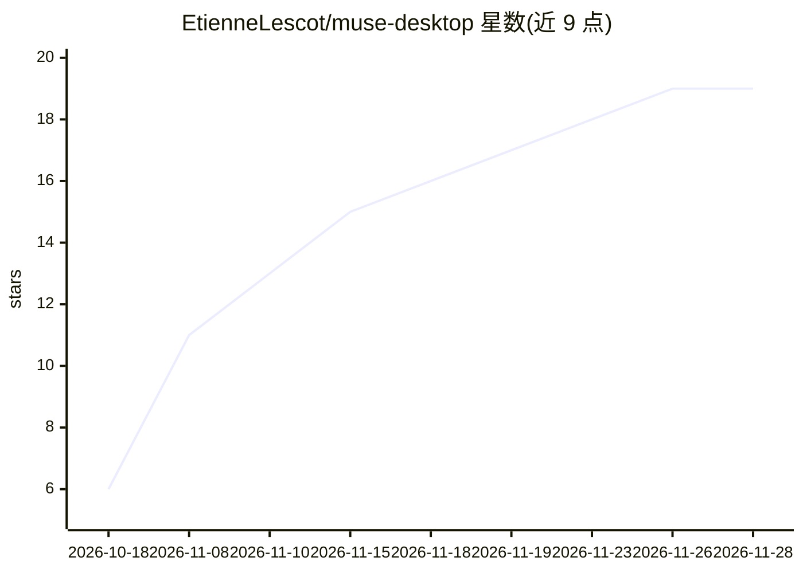

# EtienneLescot/muse-desktop

⭐ 19 · JavaScript · MIT · 推送 2026-10-18 · [GitHub](https://github.com/EtienneLescot/muse-desktop) · 个人维护

**Meta Muse Code 编码代理的桌面客户端，含可选电脑操作**

基于 Tauri/React/Vite 构建的桌面应用，为 Meta 的 CLI 编码代理 Muse Code 提供图形界面：项目管理、git worktree、子代理、MCP 工具接入、diff 审查面板。可选开启 computer use，让代理截屏观察或操作鼠标键盘，分三级权限且默认关闭，依赖独立安装的开源 cua 驱动。应用本身不含 Muse 引擎，需单独安装 Muse Code 并用其账户认证。提供 macOS（Apple Silicon）签名 DMG 与 Windows x64 安装包，Linux 未开始。

## 筛选速览

| 维度 | 判定 | 备注 |
|---|---|---|
| AI 角色 | `ai-ecosystem` | LLM/agent 周边工具 |
| 许可风险 | `permissive` | MIT |
| 部署形态 | `library` | 以包/库形式分发 |
| 模型依赖 | — | README 未给出锁定关系 |
| 硬件要求 | — | 无带数字的原话,不猜 |
| 安装摩擦 | `low` | 无编译、无系统依赖或容器化 |
| 成熟度 | `idea` | |

## 能力要点

- 为 Muse Code 提供项目/会话/MCP/diff 审查的图形客户端
- computer use 三级权限（默认关闭），基于开源 cua 驱动
- 对话分叉、git worktree 隔离工作副本、上下文占用指示与一键压缩
- macOS DMG 已签名公证，Windows 安装包未签名

## 适用场景

- 不想用命令行、以图形界面使用 Muse Code 编码代理
- 让代理在无 API 的本地应用里代为点选和填表
- 按项目组织会话并在隔离的 git worktree 中让代理工作

## 场景标签

`编码 Agent` `GUI 自动化` · 领域:效率与自动化

## 证据(README 行号)

> L12: Muse Code is Meta's coding agent, and it ships as a CLI. Muse-Desktop is the harness that
> L14: Muse. Projects, git worktrees, subagents, MCP, a diff review panel. And an agent that can

## 星数曲线

2026-10-18 6 → 2026-11-28 19（+13）

---
*卡片 v1 · prompt 1.4 · 生成 2026-11-18 · 置信度 high · 依据 README sha `e3614aeeac85` · [字段定义](../../DATASET.md)*
