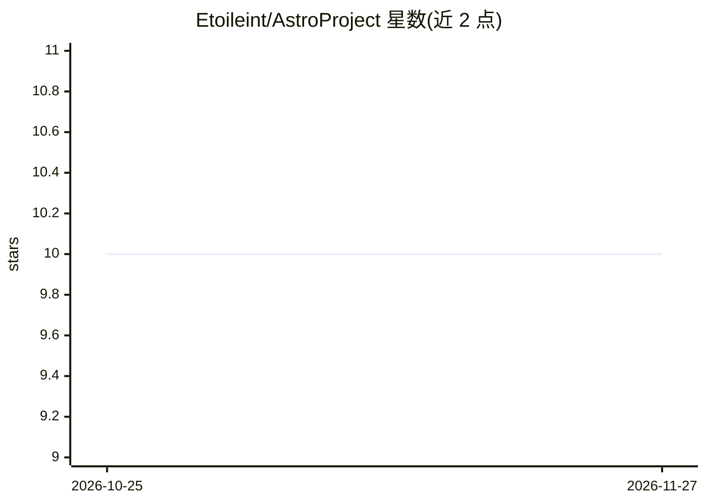

# Etoileint/AstroProject

⭐ 10 · Python · Apache-2.0 · 推送 2026-07-28 · [GitHub](https://github.com/Etoileint/AstroProject) · [官网](https://pypi.org/project/astrocrawl/) · 个人维护 · 中文 README

**四包 monorepo：含 Playwright 异步爬虫与插件平台**

AstroProject 晚星计划是由四个可独立 pip install 的包组成的 monorepo：astroframe 提供插件运行时（entry_points 发现、沙箱、签名验证、调度）；astrocrawl 是基于 Playwright headless Chromium 的异步爬虫，支持 JavaScript 渲染、RFC 9309 robots.txt、声明式 CSS 规则引擎及多 Provider 的 AI 提取，附带 PySide6 GUI 与 CLI；astrobasis 为纯标准库机制层；astroweave 为规划中的 DAG 工作流引擎。面向需要数据抓取与插件化架构的开发者。

## 筛选速览

| 维度 | 判定 | 备注 |
|---|---|---|
| AI 角色 | `ai-enhanced` | 去掉 AI 部分产品仍成立 |
| 许可风险 | `permissive` | Apache-2.0 |
| 部署形态 | `library` | 以包/库形式分发 |
| 模型依赖 | — | README 未给出锁定关系 |
| 硬件要求 | — | 无带数字的原话,不猜 |
| 安装摩擦 | `low` | 无编译、无系统依赖或容器化 |
| 成熟度 | — | 结构信号不足 |

## 能力要点

- astrocrawl：Playwright Chromium 异步爬取与 JS 渲染
- robots.txt RFC 9309 合规与声明式 CSS 规则引擎
- astroframe 插件运行时：entry_points 发现、4 层沙箱、sigstore/GPG 签名验证
- 每个包可独立 pip install，自由组合

## 适用场景

- 抓取需要 JavaScript 渲染的网页内容
- 在遵守 robots.txt 的前提下批量采集数据
- 基于插件平台搭建可扩展的应用运行时

## 场景标签

`网页抓取` · 领域:效率与自动化

## 证据(README 行号)

> L27: |**astrocrawl**|摘星|摘其明者，揽百斗星|专业级异步网页爬虫 — Playwright Chromium、robots.txt RFC 9309、声明式规则引擎、AI 多 Provider 底座、PySide6 G
> L26: |**astroframe**|筑穹|筑其基者，擎九霄穹|通用插件平台运行时 — entry_points 发现、4 层沙箱防御、sigstore/GPG 签名验证、COLLECTOR/CHAIN 调度|

## 星数曲线

2026-10-25 10 → 2026-11-27 10（+0）

---
*卡片 v1 · prompt 1.4 · 生成 2026-11-20 · 置信度 mid · 依据 README sha `5e1cd2a81794` · [字段定义](../../DATASET.md)*
