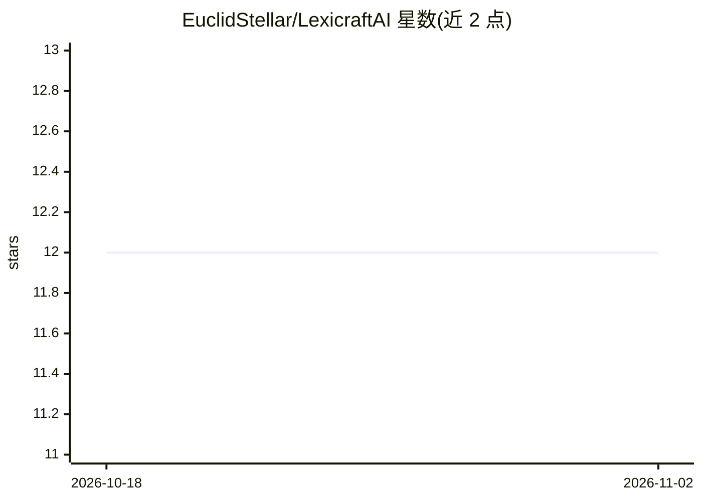

# EuclidStellar/LexicraftAI

⭐ 12 · JavaScript · 推送 2026-04-29 · [GitHub](https://github.com/EuclidStellar/LexicraftAI) · [官网](https://lexicraftai.vercel.app) · 个人维护

**面向小说/剧本作者的 AI 写作套件（改写/语法/情节/角色）**

基于 React 的开源 Web 写作套件，通过 Google Gemini API 为作者、编剧提供改写器、语法与风格检查、可读性优化、语气分析、摘要等核心工具，以及章节化管理手稿、场景构建反馈、三幕结构等情节框架分析和角色一致性检查等创作工具。需 Node.js/npm 环境，克隆仓库后安装依赖、配置 Gemini API Key（UI 或 .env），npm start 启动开发服务器，浏览器访问 localhost:3000 使用。README 自述定位为 QuillBot 等付费平台的免费替代。

## 筛选速览

| 维度 | 判定 | 备注 |
|---|---|---|
| AI 角色 | `ai-native` | 本体是模型或模型工具 |
| 许可风险 | `none` | — |
| 部署形态 | `library` | 以包/库形式分发 |
| 模型依赖 | — | README 未给出锁定关系 |
| 硬件要求 | — | 无带数字的原话,不猜 |
| 安装摩擦 | `low` | 无编译、无系统依赖或容器化 |
| 成熟度 | — | 结构信号不足 |

## 能力要点

- 改写器支持多种文体与语气模式
- 情节分析对照三幕结构/英雄之旅/七点结构
- 章节化手稿管理含字数、节奏与一致性分析
- API Key 可存于浏览器本地存储

## 适用场景

- 小说或剧本创作中做改写、语法与语气润色
- 按叙事框架检查情节结构与节奏
- 管理章节手稿并跟踪角色一致性

## 场景标签

`AI 写作` · 领域:内容生成

## 证据(README 行号)

> L3: An open-source, AI-powered writing suite designed for authors, screenwriters, and creators. This tool goes beyond si
> L27: - **AI Integration**: Google Gemini API via `geminiAPI.js`

## 星数曲线

2026-10-18 12 → 2026-11-02 12（+0）

---
*卡片 v1 · prompt 1.4 · 生成 2026-11-01 · 置信度 high · 依据 README sha `f100784e166f` · [字段定义](../../DATASET.md)*
