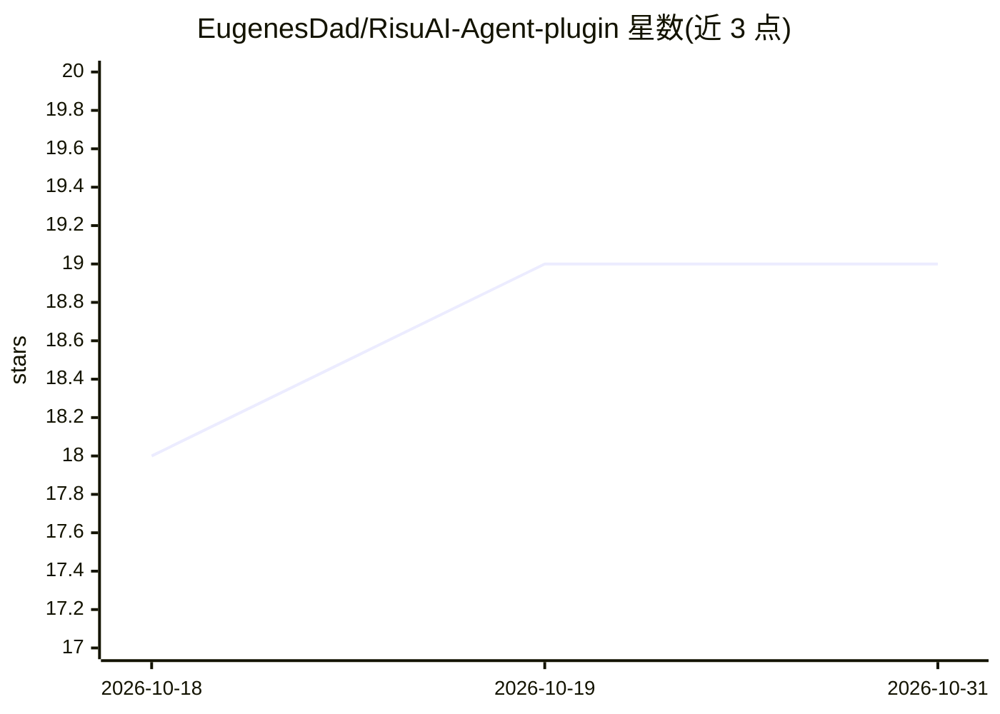

# EugenesDad/RisuAI-Agent-plugin

⭐ 19 · JavaScript · GPL-3.0 · 推送 2026-04-13 · [GitHub](https://github.com/EugenesDad/RisuAI-Agent-plugin) · 个人维护 · 中文 README

**RisuAI 角色扮演插件：后台多代理管记忆与剧情**

构建于 RisuAI 之上的插件层，将记忆管理、逻辑一致性维护与角色指导委托给后台专用 AI 代理处理，主模型专注当下表演。核心功能包括将长聊天记录蒸馏为高密度信息块、拆解重组角色卡条目并按最优位置注入 prompt、兼容既有预设；可选启用导演笔记与向量语义检索。在 RisuAI 内直接安装，设置与预设修改说明内置于界面。FAQ 提示不支持 Prefill 的模型（如 Claude、DeepSeek）需清除预填充项。

## 筛选速览

| 维度 | 判定 | 备注 |
|---|---|---|
| AI 角色 | `ai-ecosystem` | LLM/agent 周边工具 |
| 许可风险 | `viral` | GPL-3.0 |
| 部署形态 | `None` |  |
| 模型依赖 | — | README 未给出锁定关系 |
| 硬件要求 | — | 无带数字的原话,不猜 |
| 安装摩擦 | `low` | 无编译、无系统依赖或容器化 |
| 成熟度 | — | 结构信号不足 |

## 能力要点

- 长聊天记录蒸馏为高密度信息块以节省 token
- 角色卡条目拆解重组并注入 prompt 最优结构位置
- 可选导演笔记：引导剧情并实时纠正逻辑不一致
- 可选向量语义检索替代关键词匹配

## 适用场景

- 长程角色扮演对话中维持角色记忆与一致性
- 希望主模型专注于表演、由后台代理分担记忆管理
- 提升背景设定注入的相关性与密度

## 场景标签

`Agent 记忆` · 领域:Agent 开发

## 证据(README 行号)

> L13: **RisuAI Agent** is an advanced orchestration layer built on top of RisuAI. Think of it as a **versatile secretary 
> L15: Instead of forcing your main AI model to juggle memory, world-building, and acting all at once, this plugin delegat

## 星数曲线

2026-10-18 18 → 2026-10-31 19（+1）

---
*卡片 v1 · prompt 1.4 · 生成 2026-10-29 · 置信度 high · 依据 README sha `09565aeb4d71` · [字段定义](../../DATASET.md)*
