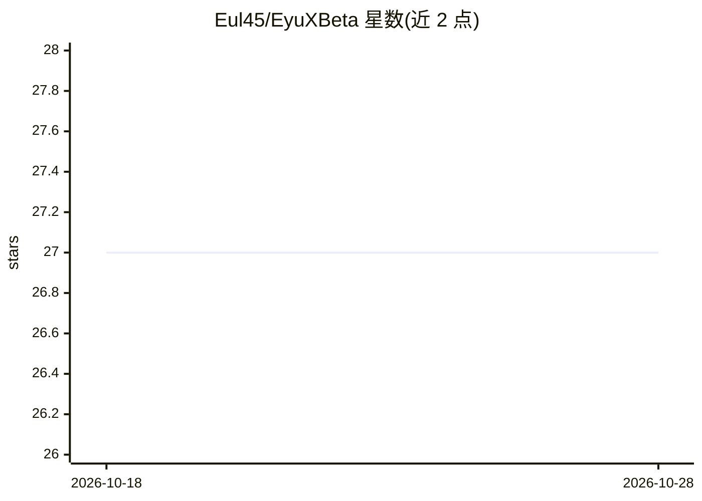

# Eul45/EyuXBeta

⭐ 27 · TypeScript · 推送 2026-02-02 · [GitHub](https://github.com/Eul45/EyuXBeta) · [官网](https://chat.eyux.com.et) · 个人维护

**多性格 AI 聊天与学习工具应用：Gemini 驱动、跨平台**

基于 React Native 与 Expo 构建的移动端与 Web AI 聊天应用，接入 Google Gemini 模型（可在 Flash 2.0/2.5 间切换）。功能包括多性格人设切换、AI 生图（/imagine）、Tavily 实时网页搜索、多线程对话树、Agent 模式多步任务、长期记忆、自然语言提醒与 Google Drive 云同步；学习/开发工具含闪卡生成、Mermaid 图表、Pyodide 浏览器内 Python 数据分析及 HTML/CSS/JS 代码画布。注意：核心源码未开源，仓库仅接受问题反馈与建议，未提供安装运行命令。

## 筛选速览

| 维度 | 判定 | 备注 |
|---|---|---|
| AI 角色 | `ai-native` | 本体是模型或模型工具 |
| 许可风险 | `none` | — |
| 部署形态 | `None` |  |
| 模型依赖 | — | README 未给出锁定关系 |
| 硬件要求 | — | 无带数字的原话,不猜 |
| 安装摩擦 | `low` | 无编译、无系统依赖或容器化 |
| 成熟度 | — | 结构信号不足 |

## 能力要点

- Gemini 多模型切换与动态 AI 人设
- Tavily 实时网页搜索（带引用来源）与 AI 生图
- Pyodide（WASM）浏览器内执行 Python 并渲染 Matplotlib 图表
- 对话树分支、长期记忆与 Google Drive 云同步

## 适用场景

- 日常 AI 对话助手与个性化聊天
- 对话内容生成闪卡辅助学习
- 在聊天中做数据分析与运行 AI 生成的网页代码

## 场景标签

`聊天机器人` `数据分析` `图像生成` · 领域:效率与自动化

## 证据(README 行号)

> L13: EyuX is more than just a chatbot. It's a versatile mobile and web companion designed to be your assistant, entertai
> L154: - **AI:** Google Generative AI (Gemini) & Tavily AI for Web Search

## 星数曲线

2026-10-18 27 → 2026-10-28 27（+0）

---
*卡片 v1 · prompt 1.4 · 生成 2026-10-26 · 置信度 high · 依据 README sha `a865eaff69fc` · [字段定义](../../DATASET.md)*
