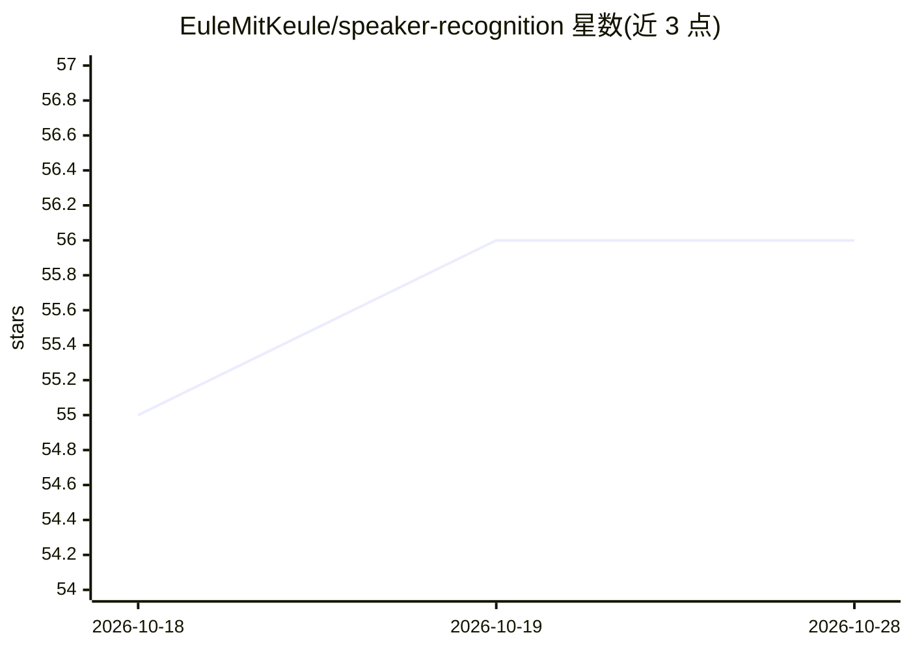

# EuleMitKeule/speaker-recognition

⭐ 56 · Python · MIT · 推送 2026-05-01 · [GitHub](https://github.com/EuleMitKeule/speaker-recognition) · 个人维护

**为 Home Assistant 提供基于声纹的说话人识别服务**

面向 Home Assistant 用户与智能家居开发者的说话人识别方案：基于 Resemblyzer 神经声纹嵌入，先用语音样本训练说话人模型，再通过 REST API 识别音频中的说话人并返回置信度。交付形态包括 FastAPI 服务（Home Assistant 插件或独立 Docker 部署）、Python 客户端库和自定义集成；集成支持 STT 实体与对话代理子项，使说话人身份可用于自动化。限制：服务端安装要求 Python <3.10，开发需 Python 3.9 与 uv。

## 筛选速览

| 维度 | 判定 | 备注 |
|---|---|---|
| AI 角色 | `ai-native` | 本体是模型或模型工具 |
| 许可风险 | `permissive` | MIT |
| 部署形态 | `self-host` | docker 或自建部署 |
| 模型依赖 | — | README 未给出锁定关系 |
| 硬件要求 | — | 无带数字的原话,不猜 |
| 安装摩擦 | `low` | 无编译、无系统依赖或容器化 |
| 成熟度 | — | 结构信号不足 |

## 能力要点

- 基于 Resemblyzer 神经声纹嵌入的说话人训练与识别（/train、/recognize REST 端点）
- Home Assistant 插件 + 自定义集成，含带说话人 ID 的 STT 实体与对话代理
- 独立 Docker 镜像与无 ML 依赖的 pip 客户端库
- 嵌入缓存与环境变量/YAML 配置

## 适用场景

- 家庭语音助手中区分不同说话人并按人执行自动化
- 为任意平台通过 REST API 接入声纹识别
- 用 Python 客户端程序化管理说话人训练与识别

## 场景标签

`语音识别` · 领域:感知与多模态

## 证据(README 行号)

> L7: **Identify speakers by their voice using machine learning.** This project provides a complete speaker recognition so
> L11: - 🎤 **Voice-based speaker identification** using neural embeddings
> L16: - 🎯 **High accuracy** powered by Resemblyzer voice embeddings

## 星数曲线

2026-10-18 55 → 2026-10-28 56（+1）

---
*卡片 v1 · prompt 1.4 · 生成 2026-10-24 · 置信度 high · 依据 README sha `d3fdb28497de` · [字段定义](../../DATASET.md)*
