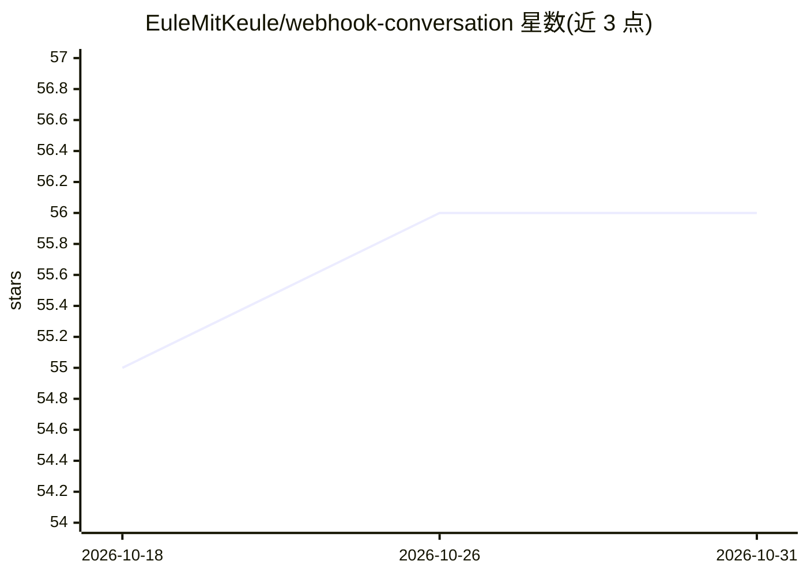

# EuleMitKeule/webhook-conversation

⭐ 56 · Python · MIT · 推送 2026-09-07 · [GitHub](https://github.com/EuleMitKeule/webhook-conversation) · 个人维护

**Home Assistant 集成：把 n8n 等 webhook 系统接入为对话代理与语音助手**

Home Assistant 自定义集成，将外部 webhook 系统（如 n8n 工作流）接入 Home Assistant 的对话代理、AI 任务、TTS 与 STT 体系。通过配置 Webhook URL、输出字段、超时（1-300 秒）与系统提示词，把对话上下文与暴露实体 POST 到外部端点并接收回复，支持响应流式输出、文件附件（base64 编码）、STT 的 WebSocket 流式音频（PCM 元数据 + eof 标记）及 Basic HTTP 认证。附带含 OpenAI 集成的 n8n 示例工作流。要求 Home Assistant >=2026.4，经 HACS 或手动下载安装。

## 筛选速览

| 维度 | 判定 | 备注 |
|---|---|---|
| AI 角色 | `ai-ecosystem` | LLM/agent 周边工具 |
| 许可风险 | `permissive` | MIT |
| 部署形态 | `desktop` | 安装包/桌面程序 |
| 模型依赖 | — | README 未给出锁定关系 |
| 硬件要求 | — | 无带数字的原话,不猜 |
| 安装摩擦 | `low` | 无编译、无系统依赖或容器化 |
| 成熟度 | — | 结构信号不足 |

## 能力要点

- n8n 工作流等 webhook 系统可注册为对话代理、AI 任务、TTS、STT 四类实体
- 支持文件附件、响应流式输出与可配置超时（1-300 秒）
- STT 支持 WebSocket 流式音频（元数据 JSON + 二进制帧 + eof 标记）
- 提供含 OpenAI GPT 与 LangChain agent 的 n8n 示例工作流

## 适用场景

- 用 n8n 工作流承载 Home Assistant 的对话代理逻辑
- 把自定义 TTS/STT 服务接入 Home Assistant 语音助手管线
- 通过 AI Task webhook 处理带附件的结构化任务

## 场景标签

`语音 Agent` `语音合成` · 领域:对话与助手

## 证据(README 行号)

> L11: _Integration to connect Home Assistant conversation agents and AI features to external systems through webhooks._
> L13: **This integration allows you to use n8n workflows or other custom webhook-based systems as conversation agents in 

## 星数曲线

2026-10-18 55 → 2026-10-31 56（+1）

---
*卡片 v1 · prompt 1.4 · 生成 2026-10-24 · 置信度 high · 依据 README sha `3fd531bc9491` · [字段定义](../../DATASET.md)*
