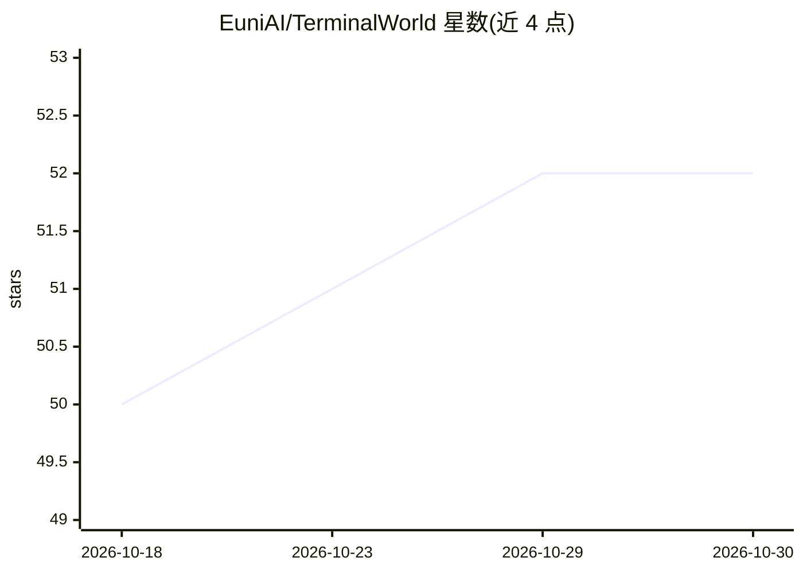

# EuniAI/TerminalWorld

⭐ 52 · Python · Apache-2.0 · 推送 2026-05-31 · [GitHub](https://github.com/EuniAI/TerminalWorld) · [官网](https://terminalworld.ai/) · 组织维护

**从真实终端录制反向构造的 agent 评测基准（1,530 任务）**

可扩展的数据引擎：爬取并过滤 80,870 条 asciinema 终端录制，经 LLM 蒸馏生成任务指令与参考解，再用 LLM agent 合成 Dockerfile 复现环境、生成状态断言测试，三重试验校验后产出 1,530 个任务、19 类、1,280 个唯一命令的终端任务基准；其中 200 任务经 4 名专家人工复核。在验证子集上对 8 个前沿 LLM 与 6 个 agent 框架评测，最佳系统通过率 62.5%。供科研人员评测终端 agent 能力使用，附论文、数据集与代码仓库。

## 筛选速览

| 维度 | 判定 | 备注 |
|---|---|---|
| AI 角色 | `ai-ecosystem` | LLM/agent 周边工具 |
| 许可风险 | `permissive` | Apache-2.0 |
| 部署形态 | `self-host` | docker 或自建部署 |
| 模型依赖 | — | README 未给出锁定关系 |
| 硬件要求 | — | 无带数字的原话,不猜 |
| 安装摩擦 | `low` | 无编译、无系统依赖或容器化 |
| 成熟度 | — | 结构信号不足 |

## 能力要点

- 80,870 条录制经四阶段流水线过滤为 1,530 个验证任务
- LLM 合成 Dockerfile 复现环境，禁止假二进制与桩依赖
- 三重试验（全通过/Nop/Partial）保证可解性、非平凡性与区分度
- 200 任务子集由 4 名专家端到端人工复核

## 适用场景

- 评测 LLM agent 在真实终端任务上的执行能力
- 研究录制数据与专家编制基准的能力差异
- 获取带 Docker 环境与测试套件的终端任务数据集

## 场景标签

`模型评测` `科研工具` · 领域:评测与运维

## 证据(README 行号)

> L3: **TerminalWorld** is a scalable data engine that automatically reverse-engineers high-fidelity evaluation tasks from
> L93: Benchmarking on the Verified subset across 8 frontier LLMs and 6 agent frameworks shows that the best system (Claud
> L109: @article{chu2026terminalworld,

## 星数曲线

2026-10-18 50 → 2026-10-30 52（+2）

---
*卡片 v1 · prompt 1.4 · 生成 2026-10-24 · 置信度 mid · 依据 README sha `cf9a5f0fb2d0` · [字段定义](../../DATASET.md)*
