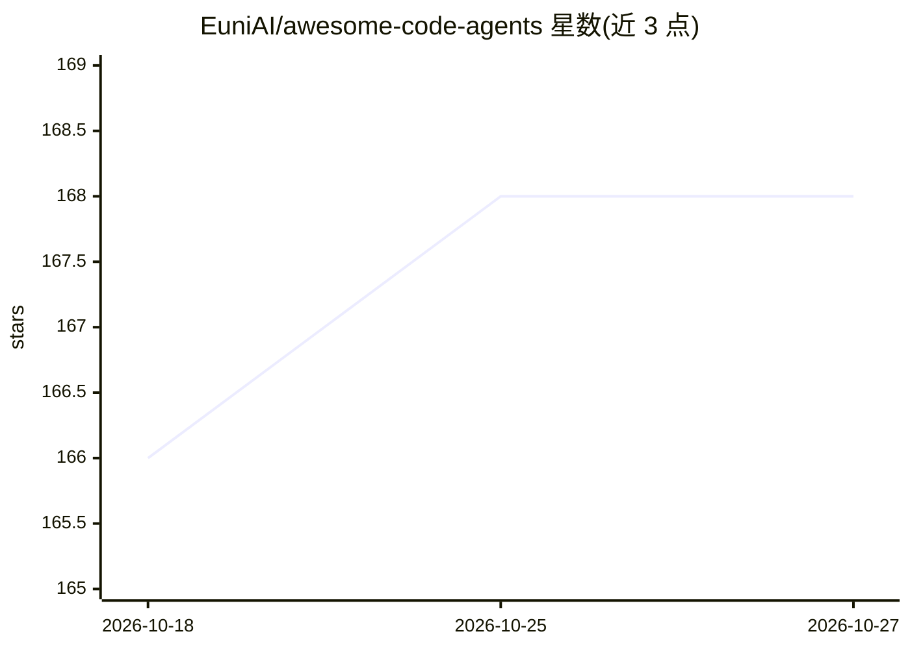

# EuniAI/awesome-code-agents

⭐ 168 · Python · Apache-2.0 · 推送 2026-10-26 · [GitHub](https://github.com/EuniAI/awesome-code-agents) · [官网](https://euniai.github.io/awesome-code-agents/) · 组织维护

**自主代码 agent 前沿研究论文策展清单（470 篇）**

持续更新的代码 agent 领域论文聚合清单，已收录 470 篇（标注更新至 2026-07-12），按基础模型、综述与实证研究、代码构建（调试/_issue 修复等）等主题分类组织；条目包含论文标题、作者、arXiv 年月及 Paper/Model/Benchmark 等标签链接，README 仅展示近一年条目，完整清单另存。面向跟踪该领域研究进展的开发者与研究人员，无安装或运行组件。

## 筛选速览

| 维度 | 判定 | 备注 |
|---|---|---|
| AI 角色 | `ai-knowledge` | 知识聚合/清单类 |
| 许可风险 | `permissive` | Apache-2.0 |
| 部署形态 | `None` |  |
| 模型依赖 | — | README 未给出锁定关系 |
| 硬件要求 | — | 无带数字的原话,不猜 |
| 安装摩擦 | `medium` | 含编译或系统依赖之一 |
| 成熟度 | — | 结构信号不足 |

## 能力要点

- 收录 470 篇代码 agent 相关论文并持续更新
- 按基础模型/综述实证/代码构建等主题分类组织
- 条目附 Paper、Model、Benchmark、Empirical Study 等标签链接

## 适用场景

- 查找代码 agent 领域的最新论文与基准测试
- 按主题浏览 SWE agent 研究脉络
- 跟踪基础模型与 agent 框架的实证研究

## 场景标签

`精选清单` · 领域:学习与行业

## 证据(README 行号)

> L7: *A living collection of frontier research on autonomous code agents, from the code we build to the worlds we act in.
> L33: 📚 *Currently collected:* **`470` papers.** *(Last update: 2026-07-12)*
> L39: ## 🧠 Foundation Models

## 星数曲线

2026-10-18 166 → 2026-10-27 168（+2）

---
*卡片 v1 · prompt 1.4 · 生成 2026-10-23 · 置信度 high · 依据 README sha `9adf0533cea6` · [字段定义](../../DATASET.md)*
