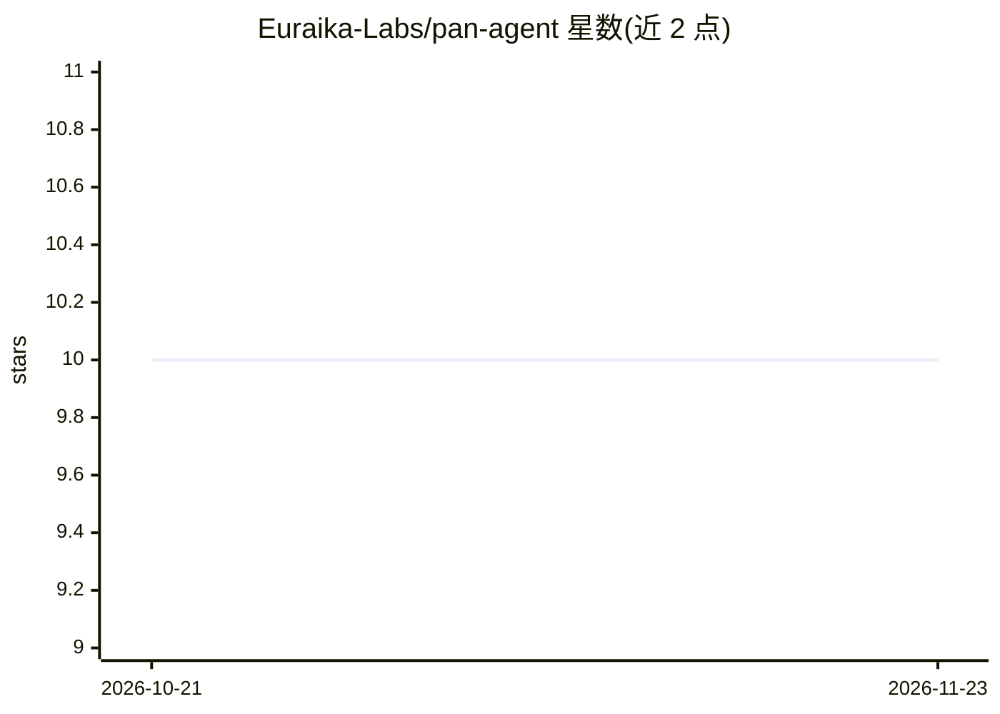

# Euraika-Labs/pan-agent

⭐ 10 · Go · MIT · 推送 2026-07-25 · [GitHub](https://github.com/Euraika-Labs/pan-agent) · [官网](https://git.euraika.net/euraika/pan-agent) · 组织维护 · 中文 README

**自托管 AI 桌面代理：单 Go 二进制控制 PC**

以单个 Go 二进制与 Tauri 桌面应用形式发布的自托管 AI 代理：可连接任意 OpenAI 兼容 LLM，提供 20+ 工具覆盖终端、文件系统、浏览器、截屏/键鼠/窗口/OCR 等 PC 控制及视觉、图像生成、TTS 等 AI 能力；内置 103 模式审批系统拦截危险命令，支持 Telegram/Discord/Slack 机器人接入、HTTP API 无头运行（50 个端点）、跨会话持久记忆与多 profile 隔离、SKILL.md 技能扩展与 cron 定时任务。面向希望本地掌控数据与代理行为的个人用户。

## 筛选速览

| 维度 | 判定 | 备注 |
|---|---|---|
| AI 角色 | `ai-native` | 本体是模型或模型工具 |
| 许可风险 | `permissive` | MIT |
| 部署形态 | `desktop` | 安装包/桌面程序 |
| 模型依赖 | local-ok | 支持本地模型 |
| 硬件要求 | — | 无带数字的原话,不猜 |
| 安装摩擦 | `low` | 无编译、无系统依赖或容器化 |
| 成熟度 | — | 结构信号不足 |

## 能力要点

- 20+ 内置工具：终端、文件系统、浏览器、截屏、键鼠、OCR、视觉、TTS 等
- 103 模式审批系统将命令分级为 Safe/Dangerous/Catastrophic 并拦截后者
- HTTP API 50 个端点无头运行，可从任意语言脚本调用
- Telegram/Discord/Slack 机器人网关与 cron 定时代理任务

## 适用场景

- 让 AI 代理在本机执行文件整理、窗口管理、网页浏览等操作
- 通过 Telegram/Discord 随时与家中代理对话下发任务
- 用 HTTP API 将代理能力脚本化集成到自有流程
- 配置本地 LLM 后离线运行代理

## 场景标签

`GUI 自动化` `AI 助手` · 领域:效率与自动化

## 证据(README 行号)

> L5: **An AI desktop agent with full PC control.**
> L20: Pan-Agent is a self-hosted AI assistant that runs on your own machine. It can:
> L23: - 🖥️ **Control your PC** — take screenshots, type, click, manage windows, run commands, browse the web

## 星数曲线

2026-10-21 10 → 2026-11-23 10（+0）

---
*卡片 v1 · prompt 1.4 · 生成 2026-11-20 · 置信度 high · 依据 README sha `ba009a208d4c` · [字段定义](../../DATASET.md)*
