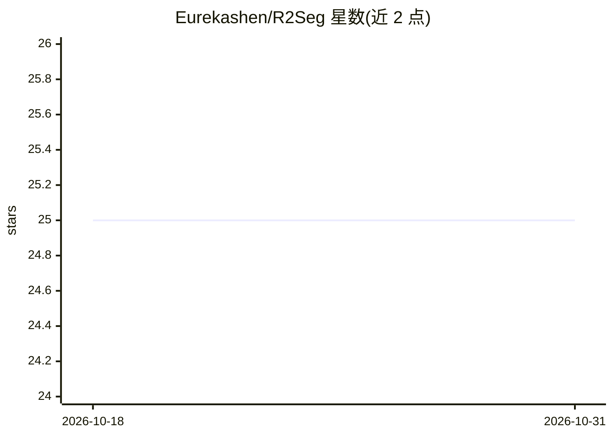

# Eurekashen/R2Seg

⭐ 25 · Python · Apache-2.0 · 推送 2026-06-29 · [GitHub](https://github.com/Eurekashen/R2Seg) · [官网](https://eurekashen.github.io/R2Seg/) · 组织维护

**免训练的医学OOD肿瘤分割框架：LLM解剖推理+统计拒绝**

面向医学图像分割的研究框架：在分布外（OOD）肿瘤场景下，用两阶段 Reason-and-Reject 流程抑制假阳性。Reason 步骤通过 OpenAI 兼容端点的 LLM 生成器官锚点与多尺度 ROI 计划（无 key 时回退到确定性模板）；Reject 步骤对冻结的 BiomedParse 基础模型输出做 GPU 加速的 MMD 置换检验与 Benjamini-Hochberg FDR 校正，仅保留与正常组织差异显著的候选。全程无参数更新，支持单图与批处理推理（Hydra 配置），需 Python 环境、CUDA 版 PyTorch 与 OPENAI_API_KEY。许可继承自 BiomedParse，仅限研究与开发用途。作者来自 CMU、剑桥、浙大等机构。

## 筛选速览

| 维度 | 判定 | 备注 |
|---|---|---|
| AI 角色 | `ai-native` | 本体是模型或模型工具 |
| 许可风险 | `permissive` | Apache-2.0 |
| 部署形态 | `library` | 以包/库形式分发 |
| 模型依赖 | — | README 未给出锁定关系 |
| 硬件要求 | — | 无带数字的原话,不猜 |
| 安装摩擦 | `medium` | 含编译或系统依赖之一 |
| 成熟度 | — | 结构信号不足 |

## 能力要点

- 免训练（training-free）OOD 肿瘤分割，无参数更新，兼容零更新测试时增强
- LLM 引导的解剖推理规划器生成器官锚点与多尺度 ROI
- GPU 加速 MMD 置换检验 + BH FDR 校正做统计拒绝，过滤假阳性
- 提供单图与批量推理 CLI，保存中间结果与指标以保证可复现

## 适用场景

- 在 OOD 肿瘤数据上做免微调的分割并抑制碎片化假阳性
- 多中心、多模态肿瘤分割基准评测
- 研究生成式 AI 规划与统计检验结合的医学影像管线

## 场景标签

`目标检测` · 领域:感知与多模态

## 证据(README 行号)

> L15: Foundation models for medical image segmentation struggle under out-of-distribution (OOD) shifts, often producing f
> L25: - **LLM reasoning for anatomy:** `tta_pipeline.llm_inference` queries an OpenAI-compatible endpoint to propose anch

## 星数曲线

2026-10-18 25 → 2026-10-31 25（+0）

---
*卡片 v1 · prompt 1.4 · 生成 2026-10-27 · 置信度 mid · 依据 README sha `b2c4cb77f5d0` · [字段定义](../../DATASET.md)*
