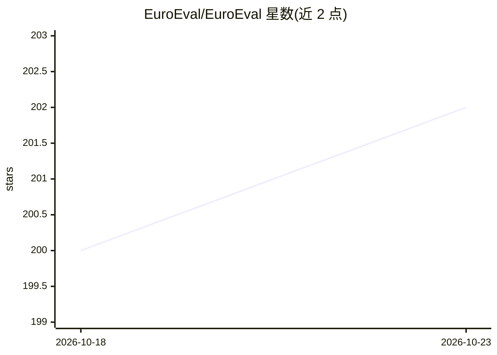

# EuroEval/EuroEval

⭐ 202 · Python · MIT · 推送 2026-10-16 · [GitHub](https://github.com/EuroEval/EuroEval) · [官网](https://euroeval.com) · 个人维护

**欧洲语言模型评测基准框架（前身为 ScandEval）**

面向欧洲语言的语言模型评测基准，前身为 ScandEval，维护者为 Alexandra 的 Dan Saattrup Smart。README 本身较简略：声明用途与更名历史，指向外部文档获取安装与使用说明；提供数据集生成脚本，可用 uv 运行 src/scripts/dataset_creation 下的脚本复现评测数据集；设有志愿者 GPU worker 社区评测机制，并接受 Google、OpenAI 等机构赞助的 API 额度用于模型评测；附有论文引用格式。

## 筛选速览

| 维度 | 判定 | 备注 |
|---|---|---|
| AI 角色 | `ai-ecosystem` | LLM/agent 周边工具 |
| 许可风险 | `permissive` | MIT |
| 部署形态 | `library` | 以包/库形式分发 |
| 模型依赖 | — | README 未给出锁定关系 |
| 硬件要求 | — | 无带数字的原话,不猜 |
| 安装摩擦 | `low` | 无编译、无系统依赖或容器化 |
| 成熟度 | — | 结构信号不足 |

## 能力要点

- 欧洲语言模型评测基准，前身为 ScandEval
- 提供可复现的评测数据集生成脚本（uv run）
- 社区志愿者 GPU worker 运行评测任务
- 有配套论文（encoder vs decoder 多语言 NLU 分析）可引用

## 适用场景

- 评测欧洲语言场景下的 LLM 与编码器模型表现
- 通过脚本复现或新增评测数据集
- 以志愿者 GPU worker 参与社区评测

## 场景标签

`模型评测` · 领域:评测与运维

## 证据(README 行号)

> L7: ### The robust European language model benchmark
> L31: All datasets used in this project are generated using the scripts located in the

## 星数曲线

2026-10-18 200 → 2026-10-23 202（+2）

---
*卡片 v1 · prompt 1.4 · 生成 2026-10-22 · 置信度 low · 依据 README sha `a7314090ce71` · [字段定义](../../DATASET.md)*
