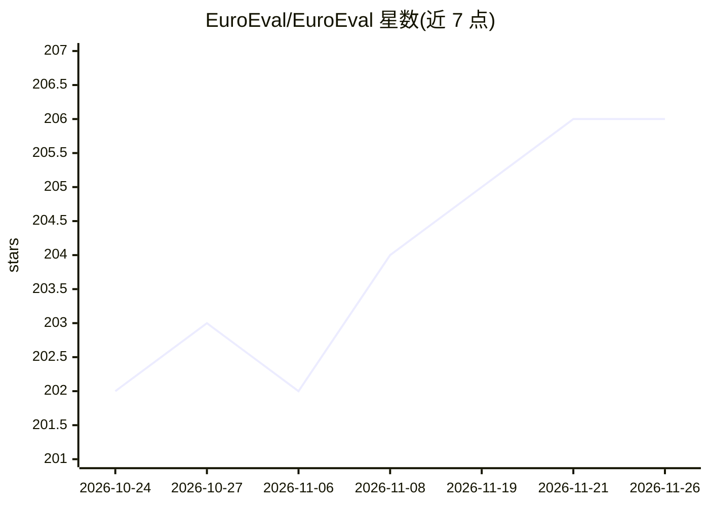

# EuroEval/EuroEval

⭐ 206 · Python · MIT · 推送 2026-11-24 · [GitHub](https://github.com/EuroEval/EuroEval) · [官网](https://euroeval.com) · 个人维护

**欧洲语言模型评测基准框架与排行榜**

欧洲语言模型基准评测框架（前身为 ScandEval）：对模型在多语言 NLP 任务数据集上进行评测，并维护公开排行榜。数据集由 src/scripts/dataset_creation 下的脚本生成，可用 uv 运行对应脚本复现。社区可贡献 bug 修复、新功能与新数据集，也可作为志愿者运行社区评测 GPU worker。框架有两篇配套论文可引用；评估部分模型依赖 Google/OpenAI/Azure 赞助的 API 额度。

## 筛选速览

| 维度 | 判定 | 备注 |
|---|---|---|
| AI 角色 | `ai-ecosystem` | LLM/agent 周边工具 |
| 许可风险 | `permissive` | MIT |
| 部署形态 | `library` | 以包/库形式分发 |
| 模型依赖 | — | README 未给出锁定关系 |
| 硬件要求 | — | 无带数字的原话,不猜 |
| 安装摩擦 | `low` | 无编译、无系统依赖或容器化 |
| 成熟度 | — | 结构信号不足 |

## 能力要点

- 欧洲语言模型评测基准与排行榜（原 ScandEval）
- 评测数据集由脚本生成，可通过 uv 运行脚本复现
- 社区贡献机制：新增数据集指南与志愿者 GPU 评测 worker
- 提供 BibTeX 引用信息与配套论文

## 适用场景

- 评估语言模型在欧洲多语言 NLP 任务上的表现
- 复现评测数据集
- 向基准贡献新数据集或参与社区评测 worker 运营

## 场景标签

`模型评测` · 领域:评测与运维

## 证据(README 行号)

> L7: ### The robust European language model benchmark
> L323: - **Volunteer GPU workers**: See the volunteer worker guide
> L25: ## Installation and usage

## 星数曲线

2026-10-24 202 → 2026-11-26 206（+4）

---
*卡片 v1 · prompt 1.4 · 生成 2026-11-25 · 置信度 high · 依据 README sha `6dc83b4704e8` · [字段定义](../../DATASET.md)*
